# Projet 4 — Dépannage et diagnostic d'un poste en panne

**Rapport d'intervention**

| | |
|---|---|
| **Cours** | IT Essentials — Mettre en service un poste de travail ICT avec le système d'exploitation (réf. CFC 187) |
| **Classe** | E1B — Geneva Institute of Technology |
| **Étudiant** | Paul « Lami » Giocanti |
| **Date d'intervention** | 16 septembre 2026 |
| **Poste de test** | PC01-PG — Windows 11 Pro 24H2 (build 10.0.26100) |
| **Environnement** | Machine virtuelle VMware Workstation, réseau VMnet8 (NAT) |
| **Compte utilisé** | tech.pg (administrateur local) |
| **Pannes traitées** | 3 — service en échec, pilote manquant, démarrage anormalement lent |

---

## Sommaire

1. [Contexte et préparation du poste](#1-contexte-et-préparation-du-poste)
2. [Méthode de diagnostic](#2-méthode-de-diagnostic)
3. [Ticket 2026-041 — Impossible d'imprimer](#3-ticket-2026-041--impossible-dimprimer)
4. [Ticket 2026-042 — Perte totale de connectivité réseau](#4-ticket-2026-042--perte-totale-de-connectivité-réseau)
5. [Ticket 2026-043 — Poste anormalement lent au démarrage](#5-ticket-2026-043--poste-anormalement-lent-au-démarrage)
6. [Synthèse des hypothèses testées](#6-synthèse-des-hypothèses-testées)
7. [Problèmes rencontrés pendant l'intervention](#7-problèmes-rencontrés-pendant-lintervention)
8. [Ce que cette intervention m'a appris](#8-ce-que-cette-intervention-ma-appris)
9. [Recommandations préventives](#9-recommandations-préventives)
10. [Annexes](#10-annexes)

---

## 1. Contexte et préparation du poste

Le service support reçoit un poste signalé en panne. Trois scénarios ont été joués successivement sur la même machine de test, chacun traité complètement — simulation, diagnostic, résolution, vérification — avant de passer au suivant.

### 1.1 Filet de sécurité : le snapshot

Avant toute intervention destructrice, un instantané complet de la machine virtuelle a été créé. Un **snapshot** est une photo de l'état intégral de la VM à un instant donné : disque, mémoire, configuration. Il permet de revenir à cet état en quelques secondes si une manipulation tourne mal.

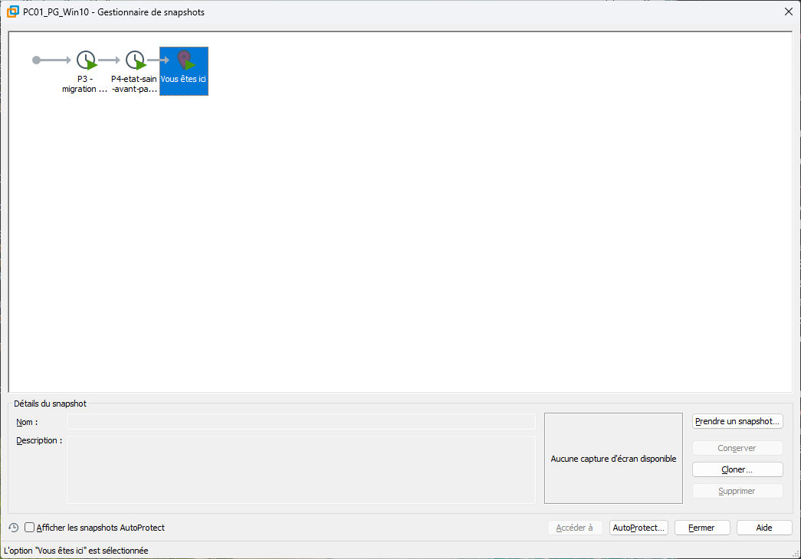

*Le gestionnaire de snapshots de VMware affiche l'instantané `P4-etat-sain-avant-pannes`, pris avant toute modification du poste. C'est le point de retour garanti pour l'ensemble de l'intervention.*

Cette étape n'est pas propre au laboratoire : en entreprise, on sauvegarde ou on crée un point de restauration avant d'intervenir sur un poste de production. Une réparation qui aggrave la situation sans possibilité de retour arrière transforme un incident en sinistre.

### 1.2 État de référence

Sans relevé de l'état sain, il est impossible de prouver ensuite qu'une panne existait ni qu'elle a été corrigée. Un script PowerShell (`p4-etat-reference.ps1`, annexe 10.1) a figé les valeurs clés du poste en état de marche.

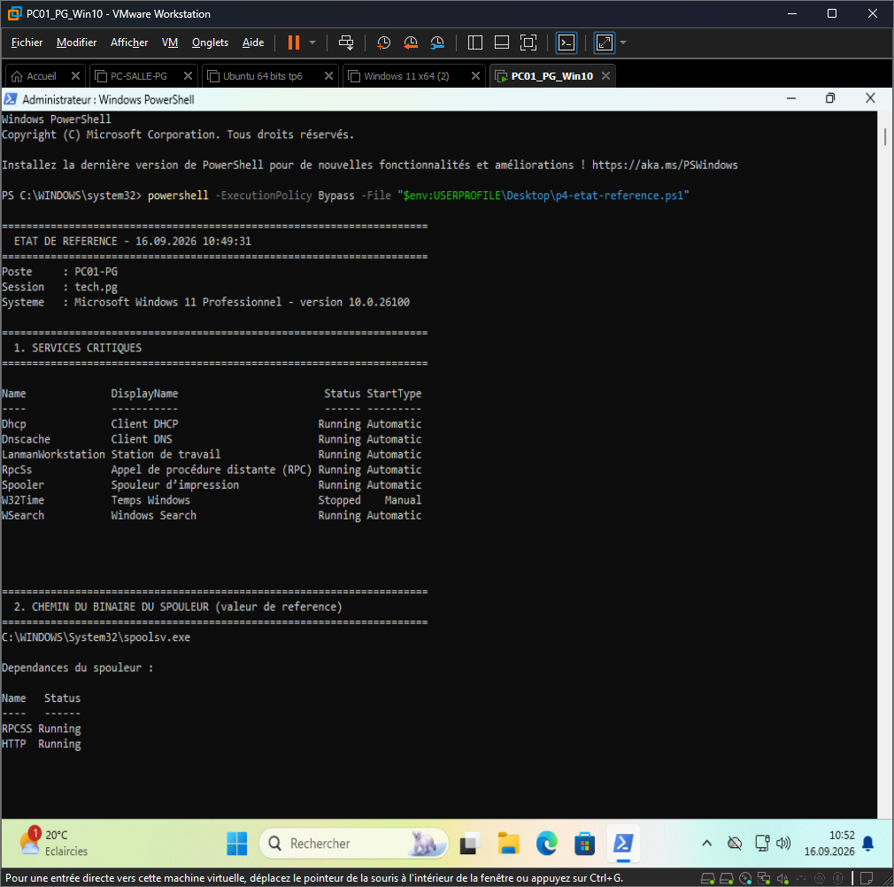

*Relevé des services critiques et de la configuration du spouleur d'impression. Le service `Spooler` est en `Running`, en démarrage `Automatic`, et son binaire est `C:\WINDOWS\System32\spoolsv.exe`. Ses dépendances sont `RPCSS` et `HTTP`, toutes deux en fonctionnement. Ce sont les valeurs auxquelles toute anomalie sera comparée.*

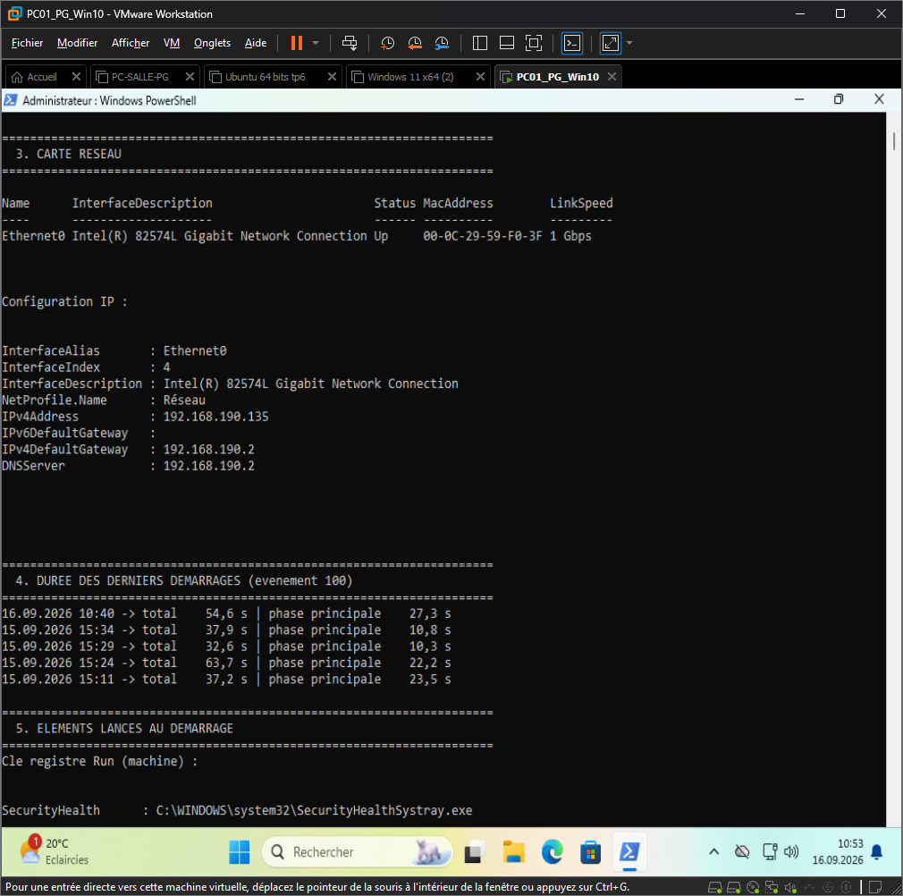

*Configuration réseau et historique des démarrages. La carte `Ethernet0` (Intel 82574L, MAC `00-0C-29-59-F0-3F`) porte l'adresse `192.168.190.135`, passerelle `192.168.190.2`, serveur DHCP `192.168.190.254`. Les durées de démarrage relevées s'échelonnent de 32,6 s à 63,7 s.*

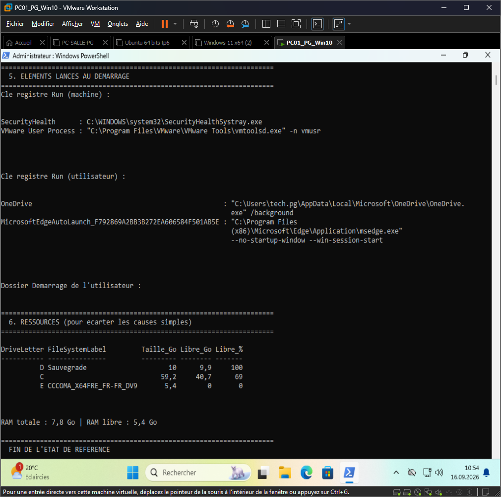

*Éléments lancés au démarrage et ressources disponibles : 40,7 Go libres sur le disque système (69 %), 7,8 Go de mémoire dont 5,4 Go libres. Ces chiffres serviront à écarter les causes « disque plein » et « mémoire saturée » avec une preuve plutôt qu'une affirmation.*

**Valeurs de référence retenues :**

| Élément | Valeur en état sain |
|---|---|
| Service Spooler | `Running` / `Automatic` |
| Binaire du spouleur | `C:\WINDOWS\System32\spoolsv.exe` |
| Dépendances du spouleur | `RPCSS`, `HTTP` |
| Carte réseau | Intel 82574L — `192.168.190.135` / passerelle `192.168.190.2` |
| Durée de démarrage moyenne | **44,8 s** (6 démarrages, valeur aberrante exclue) |
| Phase « après ouverture de session » | **25,6 s** |
| Disque système libre | 40,7 Go (69 %) |
| Mémoire libre | 5,4 Go sur 7,8 Go |

**Note de méthode — le traitement d'une valeur aberrante.** L'historique contenait un démarrage à 116,5 s, soit plus du double de tous les autres. Il correspond au redémarrage suivant les manipulations sur la carte réseau, pendant lequel Windows a redétecté et reconfiguré du matériel. Conservée, cette valeur portait la moyenne à 55,1 s et faussait toute comparaison. Elle a donc été **écartée et le motif documenté**. Supprimer une mesure en silence serait malhonnête ; l'écarter en expliquant pourquoi fait partie du travail de mesure.

---

## 2. Méthode de diagnostic

### 2.1 Les six étapes du dépannage

L'intervention applique à l'identique, aux trois pannes, la méthode en six étapes du référentiel Cisco IT Essentials / CompTIA.

| Étape | Contenu | Pourquoi elle existe |
|---|---|---|
| **1. Identifier le problème** | Recueillir le symptôme tel que l'utilisateur le décrit, relever ce qui a changé récemment, distinguer les symptômes liés des symptômes parasites | Un ticket « ça ne marche pas » n'est pas exploitable ; sans description précise, on ne peut pas vérifier la réparation |
| **2. Établir une théorie des causes probables** | Lister plusieurs causes plausibles, de la plus simple à la plus complexe | Sans liste écrite, on part dans toutes les directions et on rate l'évidence |
| **3. Tester la théorie** | Vérifier chaque hypothèse avec un outil, noter le résultat, y compris négatif | Une hypothèse écartée est une information : elle réduit le champ de recherche |
| **4. Établir un plan d'action et l'appliquer** | Choisir la correction, évaluer le risque, sauvegarder si nécessaire, agir | Une correction improvisée peut créer une seconde panne |
| **5. Vérifier le fonctionnement complet** | Retester la fonction d'origine, puis la stabilité dans le temps | Un service relancé à la main ne prouve pas qu'il repartira seul au prochain démarrage |
| **6. Documenter** | Rédiger le ticket : symptôme, hypothèses, cause, correction, preuve | C'est ce qui permet au prochain technicien de ne pas refaire le même diagnostic |

**Règle appliquée systématiquement :** aller de la cause la plus simple vers la plus complexe. On ne réinstalle pas un système avant d'avoir vérifié si un service est simplement arrêté.

### 2.2 Comment produire des hypothèses quand on ne sait pas par où commencer

C'est la difficulté réelle de l'étape 2. Deviner ne fonctionne pas ; suivre une chaîne de dépendances, si. Le principe : décomposer la fonction en panne en maillons successifs, du plus physique au plus logiciel, puis tester chaque maillon dans l'ordre et s'arrêter au premier qui casse.

**Chaîne appliquée à une panne réseau :**

| Maillon | Question posée | Outil de vérification |
|---|---|---|
| 1. Lien physique | La carte est-elle branchée / connectée ? | Diode du port Ethernet, ou paramètres VMware pour une VM |
| 2. Matériel vu par l'OS | Le système voit-il la carte ? | Gestionnaire de périphériques |
| 3. Pilote | La carte dispose-t-elle d'un pilote fonctionnel ? | Gestionnaire de périphériques, code d'erreur |
| 4. Configuration IP | La carte a-t-elle une adresse valide ? | `ipconfig /all` |
| 5. Réseau local | Joint-elle la passerelle ? | `ping 192.168.190.2` |
| 6. Sortie Internet et DNS | Sort-elle et résout-elle les noms ? | `ping 8.8.8.8`, puis `ping google.com` |
| 7. Filtrage | Le pare-feu bloque-t-il ? | Paramètres du pare-feu Windows |

**Chaîne appliquée à un service qui refuse de démarrer :**

| Maillon | Question posée | Outil de vérification |
|---|---|---|
| 1. État | Le service est-il simplement arrêté ou désactivé ? | `services.msc` |
| 2. Journal | Quelle erreur Windows a-t-il enregistrée au démarrage ? | Observateur d'événements, journal Système |
| 3. Dépendances | Les services dont il dépend fonctionnent-ils ? | Onglet Dépendances, `sc qc` |
| 4. Configuration | Le chemin du binaire déclaré est-il correct ? | `sc qc`, registre |
| 5. Fichier | Le binaire existe-t-il réellement sur le disque ? | `Test-Path` |
| 6. Droits | Le compte de service a-t-il les permissions nécessaires ? | `sc qc`, propriétés du service |

**Chaîne appliquée à un poste lent au démarrage :**

| Maillon | Question posée | Outil de vérification |
|---|---|---|
| 1. Firmware | Le BIOS/UEFI est-il lent ? | Gestionnaire des tâches, « dernier temps de démarrage du BIOS » |
| 2. Phase noyau et pilotes | Le chargement système est-il ralenti ? | Événement 100, colonne « phase principale » |
| 3. Services | Un service tarde-t-il à démarrer ? | Événement 103 |
| 4. Programmes de session | Trop de programmes se lancent-ils à l'ouverture ? | Événement 101, onglet Applications de démarrage |
| 5. Ressources | Le disque est-il plein, la mémoire saturée ? | `Get-Volume`, gestionnaire des tâches |
| 6. Persistance | D'où viennent les programmes lancés automatiquement ? | Clés `Run` du registre, dossier Démarrage |

La chaîne fait le travail à la place de l'intuition. C'est elle qui, pour la panne B, a permis d'éviter trois vérifications inutiles : le maillon 2 étant cassé, il était inutile d'aller examiner la configuration IP ou le serveur DHCP.

---

## 3. Ticket 2026-041 — Impossible d'imprimer

| | |
|---|---|
| **N° de ticket** | TICKET-2026-041 |
| **Date** | 16.09.2026, 11h02 – 13h02 |
| **Poste** | PC01-PG |
| **Criticité** | Moyenne — fonction bureautique indisponible, poste utilisable par ailleurs |
| **Catégorie** | Service système en échec |

### 3.1 Étape 1 — Identifier le problème

**Signalement utilisateur :** « Depuis ce matin je ne peux plus imprimer, mes imprimantes ont disparu de la liste. »

**Constat effectué sur le poste :** l'ouverture de *Paramètres > Bluetooth et appareils > Imprimantes et scanners* puis la tentative d'ajout d'un périphérique produit un message d'erreur explicite.

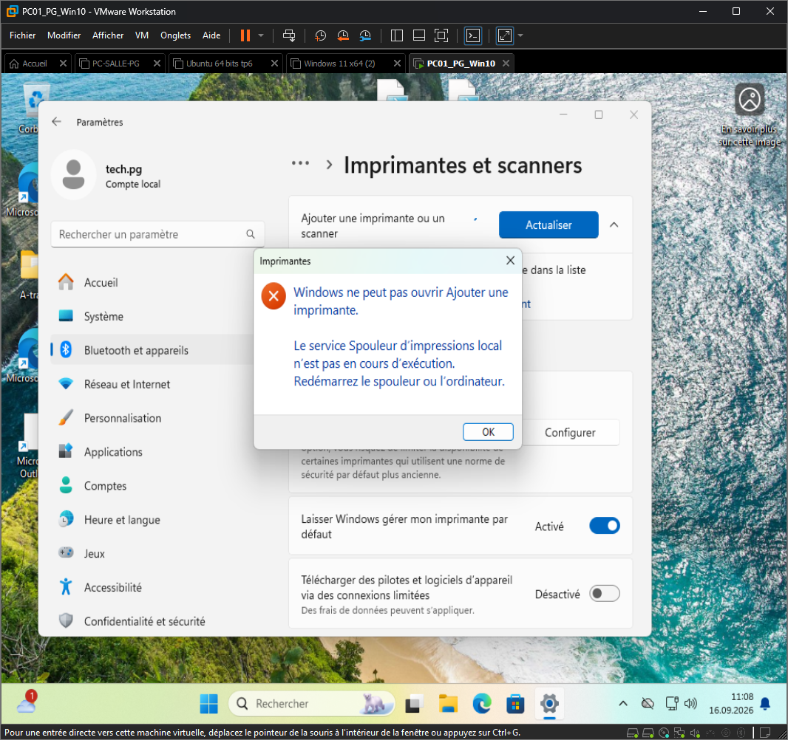

*Windows affiche « Le service Spouleur d'impressions local n'est pas en cours d'exécution. Redémarrez le spouleur ou redémarrez l'ordinateur. » Le système nomme lui-même le composant défaillant : le point de départ du diagnostic est donné.*

**Tri des symptômes.** L'écran affichait également des échecs de connexion Bluetooth et Miracast. Ces messages ont été écartés d'emblée :

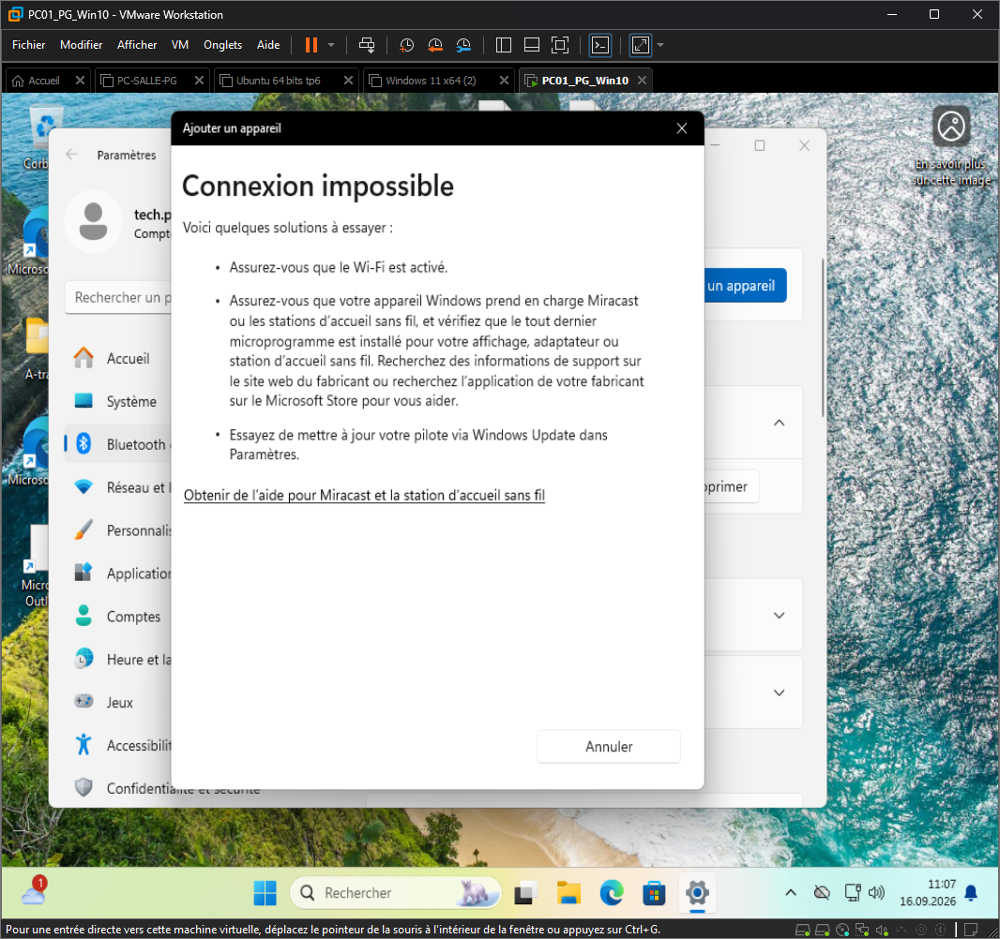

*Fenêtre « Ajouter un appareil » signalant une impossibilité de connexion Bluetooth. Ce symptôme est indépendant de la panne : la machine de test est virtuelle et VMware n'émule aucun adaptateur Bluetooth. Le message était déjà présent avant l'incident et l'est resté après réparation.*

Un utilisateur signale souvent plusieurs anomalies simultanément. Séparer ce qui est lié de ce qui ne l'est pas fait partie intégrante de l'étape 1 — partir sur le mauvais symptôme coûte plus de temps que la panne elle-même.

### 3.2 Étape 2 — Théorie des causes probables

Hypothèses formulées **avant** toute investigation, et enregistrées horodatées :

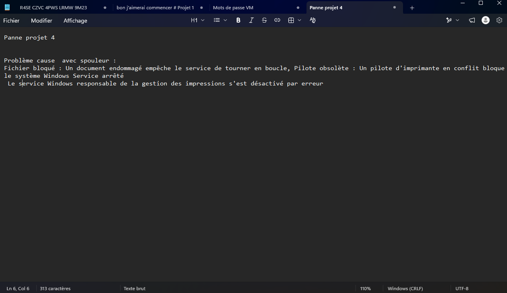

*Liste rédigée à 11h17, soit avant le premier test technique (le `sc qc` de 11h29). L'antériorité de ce relevé garantit qu'il s'agit d'un raisonnement réel et non d'une reconstitution après coup.*

| N° | Hypothèse | Raisonnement |
|---|---|---|
| H1 | Document endommagé bloqué dans la file d'attente | Cause classique de blocage d'impression |
| H2 | Pilote d'imprimante en conflit | Un pilote défaillant peut faire tomber le spouleur |
| H3 | Service arrêté ou désactivé par erreur | Cause la plus simple, à écarter en premier |
| H4 | Dépendance du service à l'arrêt | Un service peut être sain et refuser de démarrer si un autre service dont il dépend est mort |
| H5 | Configuration du service altérée (chemin du binaire) | Le message parle d'un service qui « n'est pas en cours d'exécution », pas d'un service planté |

Les hypothèses H4 et H5 ont été ajoutées après application de la chaîne « service qui refuse de démarrer » (section 2.2). Les trois premières, formulées spontanément, portaient toutes sur l'impression ; aucune ne concernait la configuration du service lui-même, qui s'est révélée être la cause.

### 3.3 Étape 3 — Test des hypothèses

**Consultation du journal Système.** Premier réflexe avant toute manipulation : lire ce que Windows a enregistré.

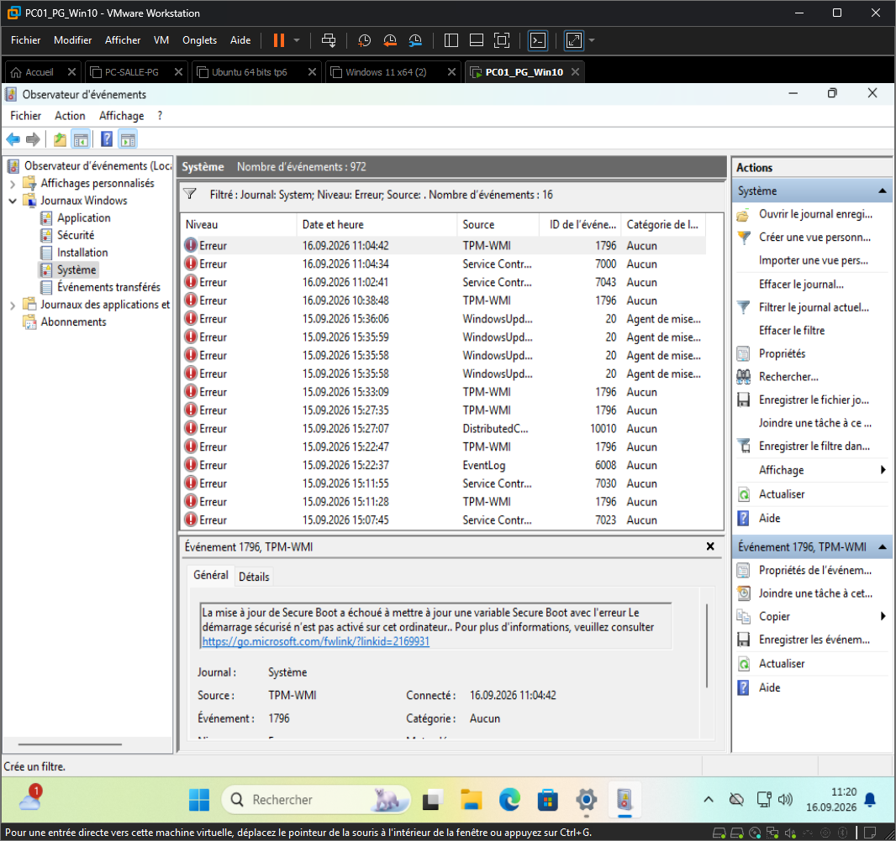

*Le journal Système contenait 972 événements ; le filtrage sur le niveau « Erreur » en isole 16, dont 4 seulement datent du jour de l'incident. Le tri par horodatage autour de l'incident est ce qui rend un journal exploitable — sans lui, on se noie.*

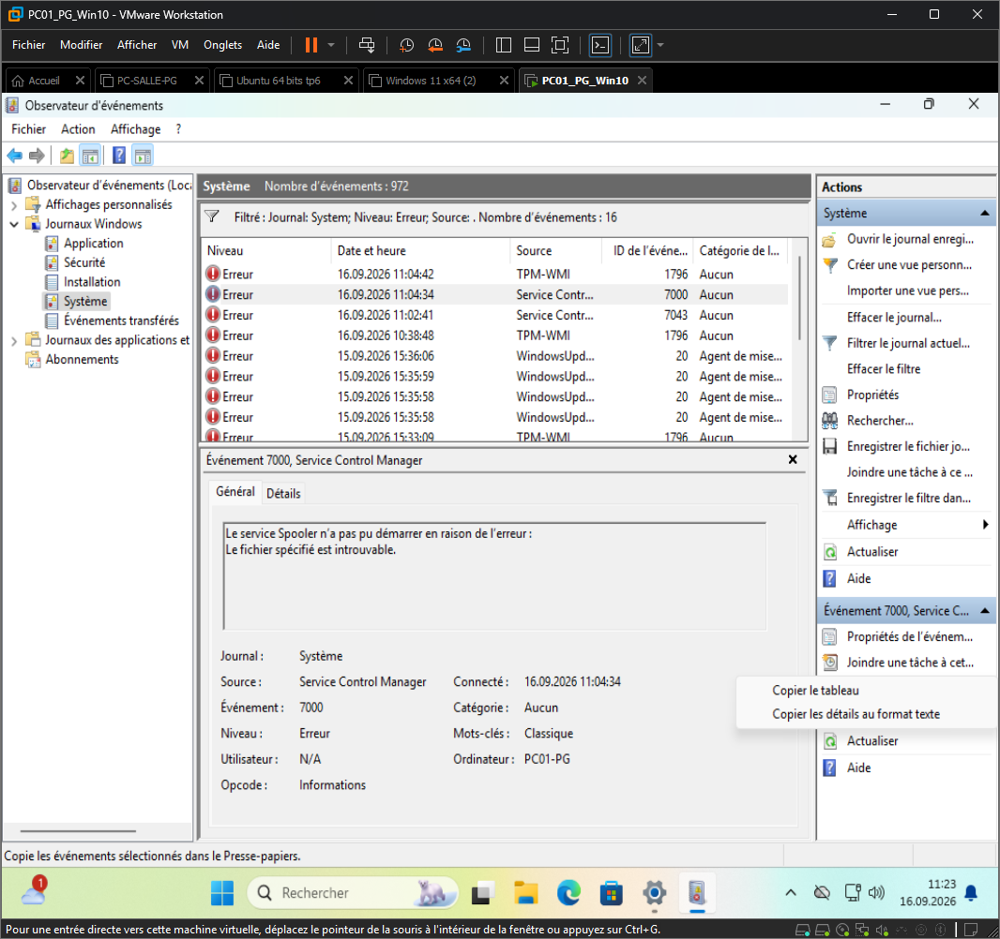

*Événement 7000, source « Service Control Manager », 16.09.2026 à 11:04:34 : « Le service Spooler n'a pas pu démarrer en raison de l'erreur suivante : Le fichier spécifié est introuvable. » Le message ne dit pas que le service a planté ni que l'accès a été refusé : il dit que Windows ne trouve pas un fichier.*

**Lecture littérale du message.** Pour démarrer un service, Windows exécute un programme dont le chemin est enregistré dans la configuration du service. « Fichier introuvable » signifie que ce chemin pointe vers un fichier absent — le service n'a donc jamais commencé à s'exécuter.

Conséquences immédiates sur les hypothèses :

- **H1 écartée** — un document corrompu bloque un service *qui tourne*, il ne l'empêche pas de démarrer.
- **H2 écartée** — les pilotes d'imprimante se chargent *après* le démarrage du service.
- **H3 écartée** — Windows indiquerait « service désactivé », pas « fichier introuvable ».

**Vérification de la configuration du service.**

*La commande `sc qc Spooler` affiche `BINARY_PATH_NAME : C:\WINDOWS\System32\spoolsvc.exe`, alors que l'état de référence indiquait `spoolsv.exe`. Un seul caractère diffère : un « c » surnuméraire. La sortie confirme par ailleurs `START_TYPE : 2 AUTO_START` et `DEPENDENCIES : RPCSS, http`, ce qui écarte définitivement H3 et H4.*

C'est ici que l'état de référence prend toute sa valeur. Sans point de comparaison, ce chemin paraît parfaitement normal : il a la bonne forme, le bon dossier, une extension attendue. **Une panne de configuration ne ressemble jamais à une panne.**

**Preuve matérielle de l'absence du fichier.**

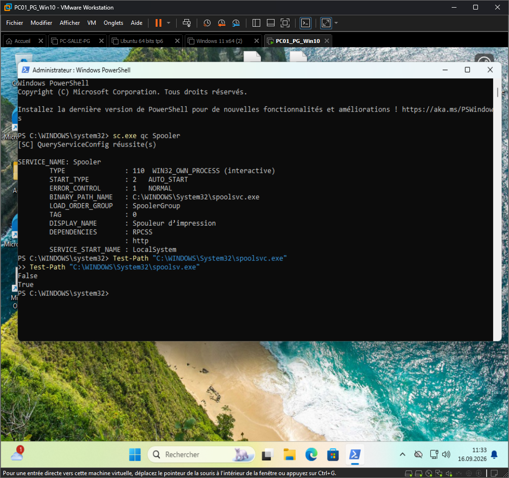

*`Test-Path "C:\WINDOWS\System32\spoolsvc.exe"` renvoie `False` — le fichier déclaré n'existe pas. `Test-Path "C:\WINDOWS\System32\spoolsv.exe"` renvoie `True` — le binaire légitime est intact et présent. La cause est donc une altération de configuration, non une corruption de fichier système.*

### 3.4 Étapes 4 et 5 — Correction et vérification

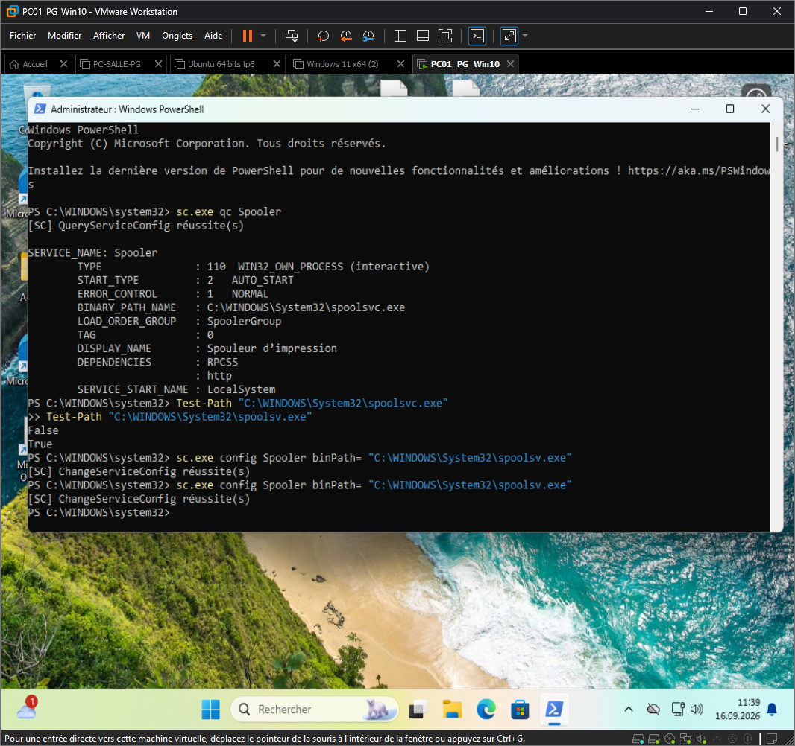

*`sc.exe config Spooler binPath= "C:\WINDOWS\System32\spoolsv.exe"` rétablit le chemin correct. L'outil officiel a été préféré à une modification directe du registre : il contrôle le format de la valeur écrite et réduit le risque d'erreur. À noter, l'espace obligatoire après `binPath=` — particularité de syntaxe de `sc.exe`.*

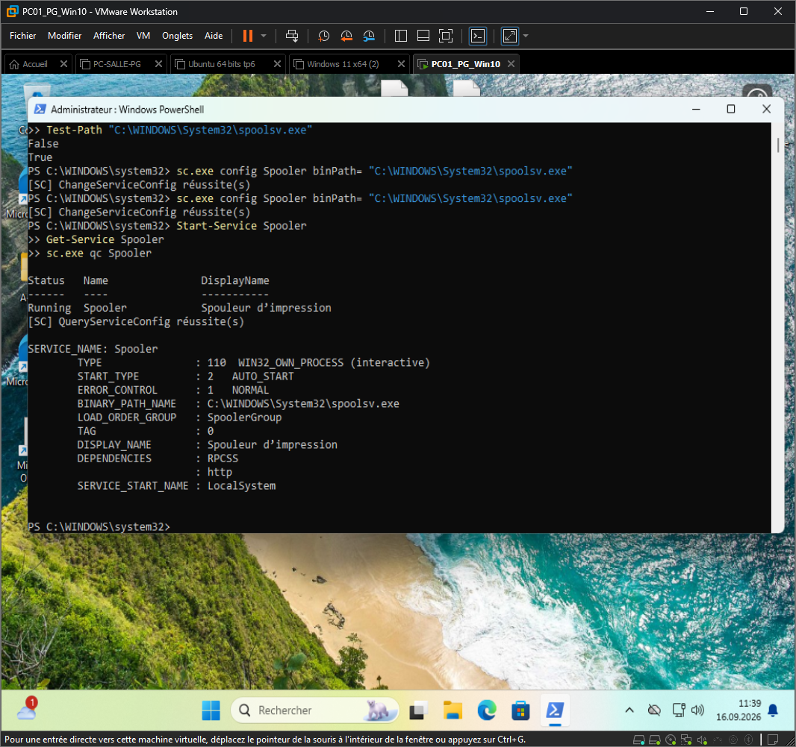

*`Start-Service Spooler` puis `Get-Service Spooler` confirment l'état `Running`. Le `sc qc` de contrôle affiche de nouveau `BINARY_PATH_NAME : C:\WINDOWS\System32\spoolsv.exe`. Cette capture et la capture 06 forment la paire avant/après de la correction.*

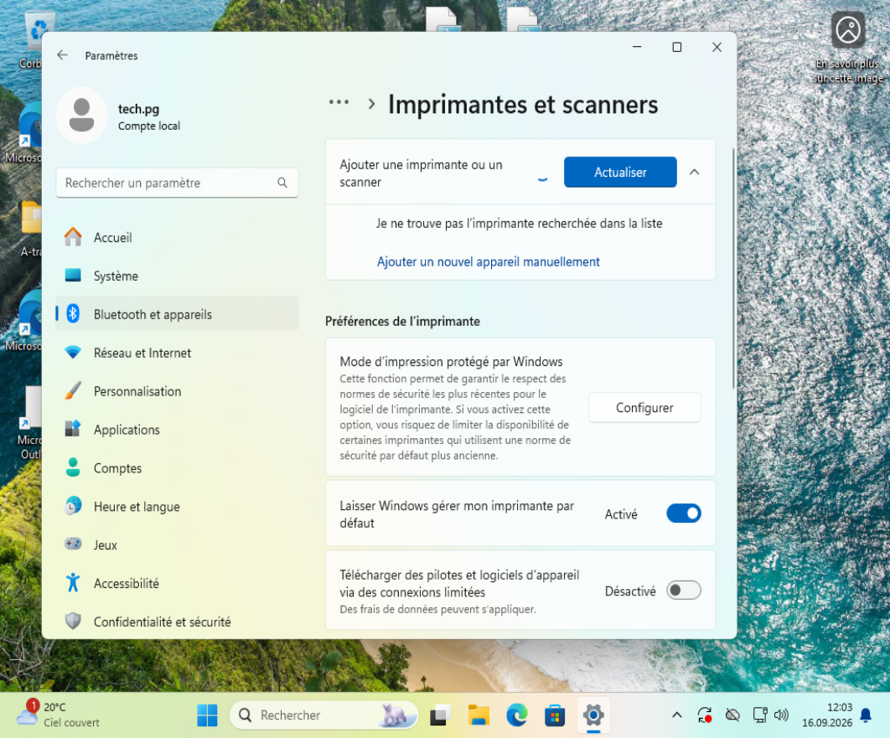

*Retour dans Paramètres > Imprimantes et scanners : la recherche de périphériques s'exécute normalement et le message d'erreur sur le spouleur n'apparaît plus. La vérification porte sur la fonction attendue par l'utilisateur, pas seulement sur l'état technique du service.*

**Vérification de la stabilité.** Un service relancé manuellement ne prouve pas qu'il redémarrera seul — or c'est précisément ce qui avait échoué.

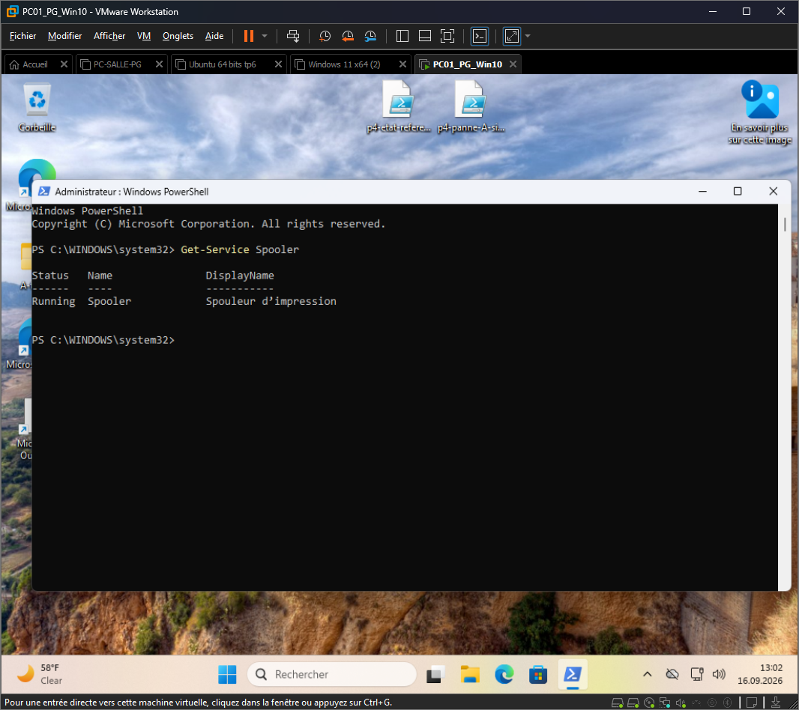

*Après redémarrage complet du poste, `Get-Service Spooler` affiche `Running` à 13:02 sans aucune intervention manuelle. Le service repart donc automatiquement, comme prévu par son type de démarrage `Automatic`.*

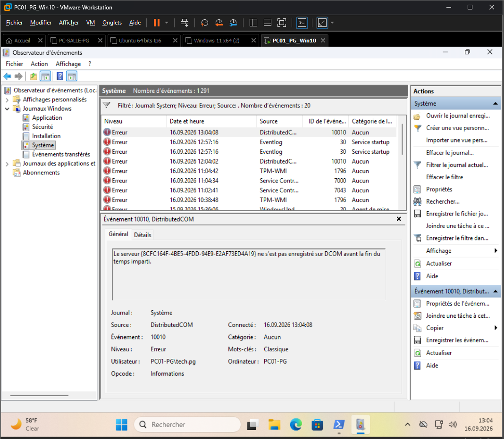

*Journal Système filtré sur les erreurs après le redémarrage de 12:57:16 — repérable aux deux entrées `Eventlog 30 — Service startup`. L'événement 7000 encore visible en liste date de 11:04:34, soit **avant** l'intervention ; aucun nouvel événement 7000 n'apparaît après le redémarrage. Les entrées `DistributedCOM 10010` et `TPM-WMI 1796` sont antérieures ou sans rapport avec le spouleur.*

Une preuve fondée sur l'absence d'erreur n'a de valeur que si la fenêtre temporelle est explicite. L'horodatage du redémarrage de validation est donc mentionné systématiquement.

### 3.5 Synthèse du ticket 041

| | |
|---|---|
| **Cause identifiée** | Valeur `ImagePath` du service `Spooler` altérée dans le registre : `spoolsvc.exe` au lieu de `spoolsv.exe` |
| **Correction appliquée** | `sc.exe config Spooler binPath= "C:\WINDOWS\System32\spoolsv.exe"` puis démarrage du service |
| **Preuve de résolution** | Service `Running` après redémarrage autonome, fonction d'impression rétablie, aucun nouvel événement 7000 |
| **Durée d'intervention** | Environ 40 minutes |
| **Hypothèses écartées** | H1 file d'attente, H2 pilote d'imprimante, H3 service désactivé, H4 dépendances — plus le symptôme Bluetooth, sans lien |

---

## 4. Ticket 2026-042 — Perte totale de connectivité réseau

| | |
|---|---|
| **N° de ticket** | TICKET-2026-042 |
| **Date** | 16.09.2026, 13h13 – 13h42 |
| **Poste** | PC01-PG |
| **Criticité** | Haute — poste isolé, aucun accès aux ressources ni à Internet |
| **Catégorie** | Périphérique matériel non piloté |

### 4.1 Étape 1 — Identifier le problème

**Signalement utilisateur :** « Plus d'accès réseau ni Internet. »

**Simulation de la panne.** Le périphérique réseau a été désinstallé via le Gestionnaire de périphériques.

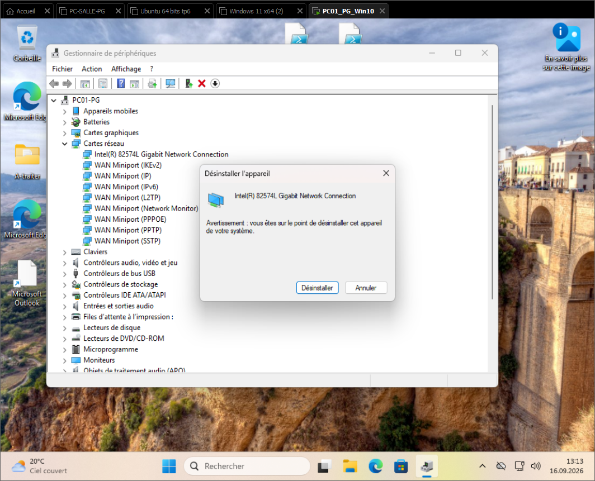

*Boîte de dialogue « Désinstaller l'appareil » pour la carte Intel(R) 82574L Gigabit Network Connection. La case « Tenter de supprimer le pilote pour cet appareil » est absente : Windows ne la propose que pour les pilotes tiers. Le pilote de cette carte étant intégré au système, seul le périphérique peut être désinstallé (voir problème P3, section 7).*

**Constat technique.**

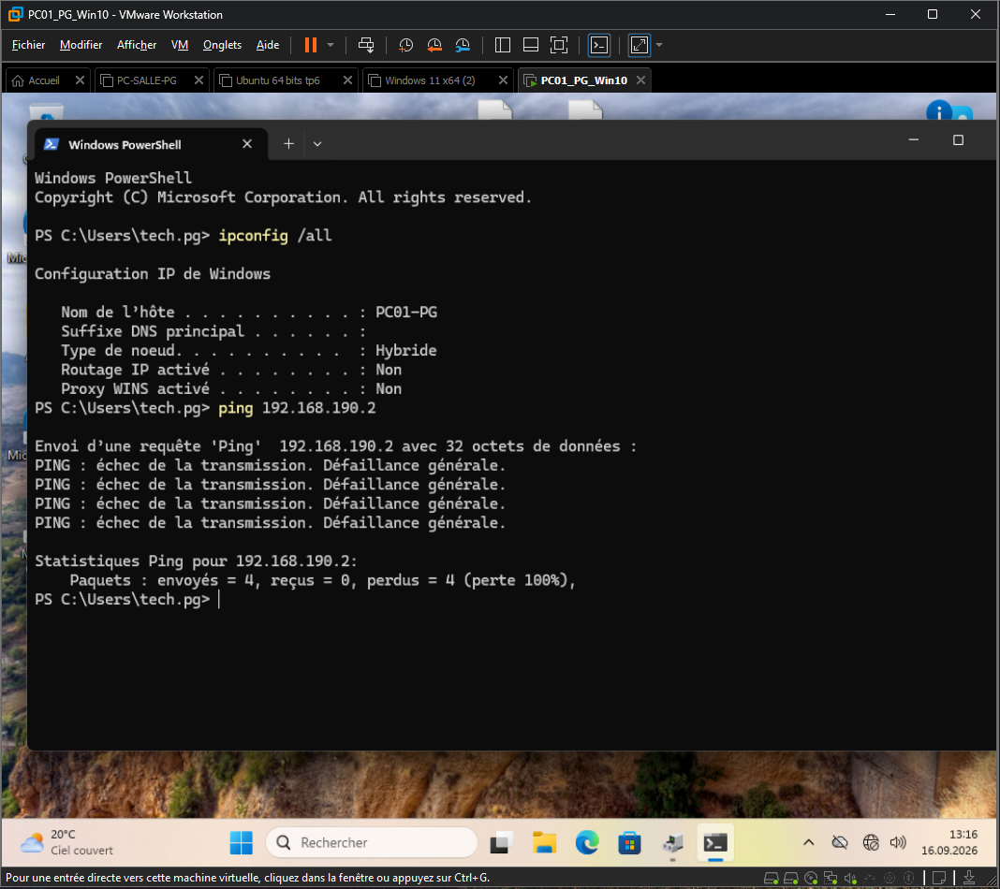

*`ipconfig /all` ne renvoie plus aucune adresse IPv4 exploitable, et `ping 192.168.190.2` vers la passerelle échoue avec 100 % de perte. À comparer avec l'état de référence (capture 02b) : adresse `192.168.190.135`, passerelle joignable.*

### 4.2 Étape 2 — Théorie des causes probables

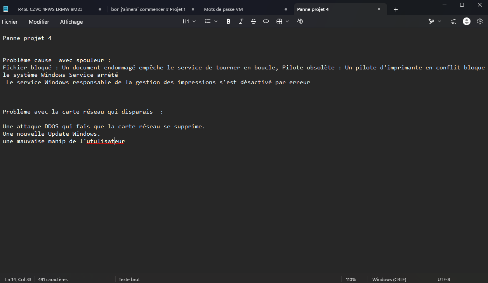

*Hypothèses rédigées avant investigation : attaque par déni de service distribué, mise à jour Windows défaillante, mauvaise manipulation de l'utilisateur.*

Évaluation de ces hypothèses spontanées :

| Hypothèse | Verdict | Motif |
|---|---|---|
| Attaque DDoS supprimant la carte | **Non retenue** | Un déni de service distribué *sature* une connexion ; il ne supprime pas un composant matériel de l'inventaire système. Un symptôme de **disparition de composant** est presque toujours d'origine locale — configuration, pilote ou matériel — et non distante. |
| Mise à jour Windows défaillante | **Retenue, plausible** | Une mise à jour cassant un pilote réseau est un incident courant en production |
| Mauvaise manipulation de l'utilisateur | **Retenue, plausible** | Correspond exactement à la cause réelle |

La chaîne réseau de la section 2.2 a ensuite été appliquée pour compléter la liste de façon systématique plutôt qu'intuitive.

### 4.3 Étape 3 — Test des hypothèses, maillon par maillon

**Maillon 1 — le lien physique.**

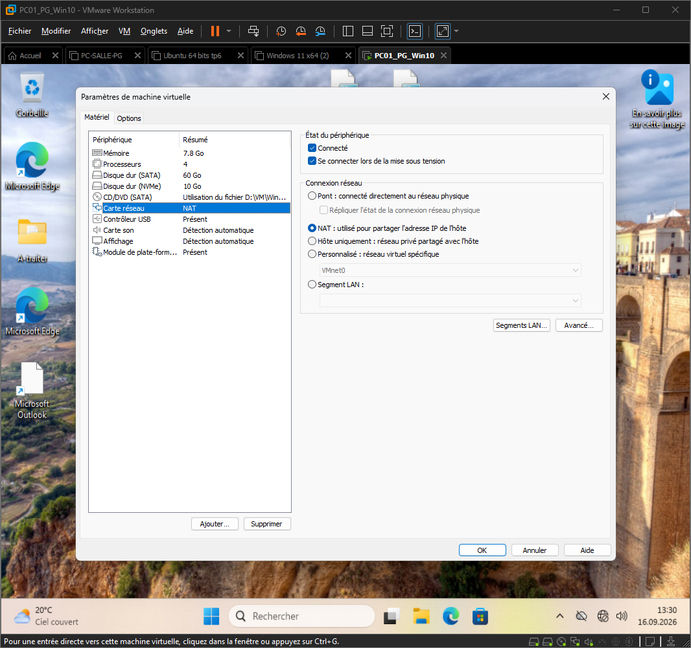

*Paramètres VMware de la machine : « Connecté » et « Se connecter lors de la mise sous tension » sont cochés, mode NAT actif. L'équivalent virtuel du câble Ethernet est donc en place. **Hypothèse « câble ou carte débranchée » écartée, avec preuve.***

Ne pas avoir trouvé la panne à cette étape n'est pas un échec : une cause éliminée réduit d'autant le champ de recherche.

**Maillon 2 — le matériel vu par le système.**

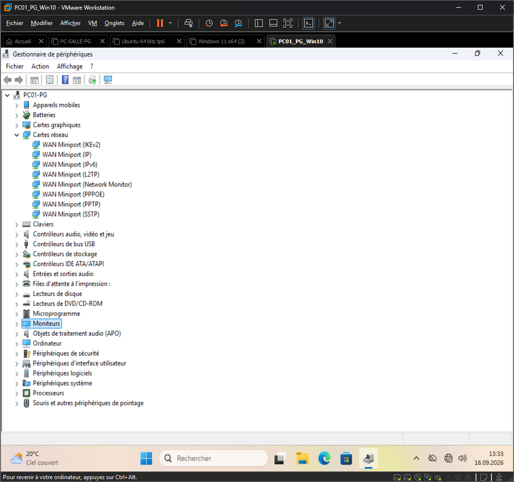

*Section « Cartes réseau » du Gestionnaire de périphériques : la carte Intel 82574L a disparu de la liste. Seuls subsistent les WAN Miniport — des pilotes logiciels utilisés par Windows pour les connexions VPN et modem (`PPPOE`, `PPTP`, `L2TP`…), présents indépendamment du matériel installé. Aucune section « Autres périphériques » n'apparaît.*

Deux enseignements de cette capture :

- **Aucune carte réseau physique n'est déclarée.** Le maillon 2 est cassé.
- **L'absence de section « Autres périphériques » est significative.** Cette section n'apparaît que lorsque Windows *détecte* un matériel qu'il ne sait pas piloter. Ici, la désinstallation a retiré le périphérique de l'inventaire : Windows ne le voit plus du tout. **Matériel mal piloté** et **matériel non détecté** sont deux pannes distinctes, avec deux traces différentes.

Le maillon 2 étant cassé, les maillons 3 à 7 — configuration IP, DHCP, passerelle, DNS, pare-feu — deviennent sans objet : sans carte déclarée, il n'y a rien à configurer. **La chaîne a évité trois vérifications inutiles.**

### 4.4 Étapes 4 et 5 — Correction et vérification

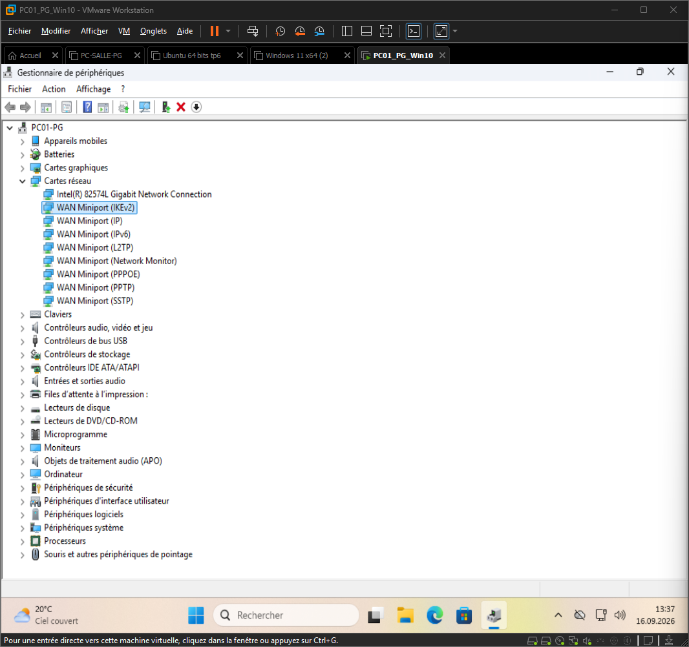

*Après « Action > Rechercher les modifications sur le matériel », la carte Intel(R) 82574L réapparaît sous Cartes réseau, sans triangle d'avertissement : elle est détectée **et** correctement pilotée.*

La réparation n'a nécessité **ni téléchargement, ni support d'installation, ni redémarrage**. Windows conserve une réserve interne de pilotes, le *magasin de pilotes* (`DriverStore`) ; le pilote de cette carte étant intégré au système, il n'en était jamais sorti. Un simple rescan a suffi.

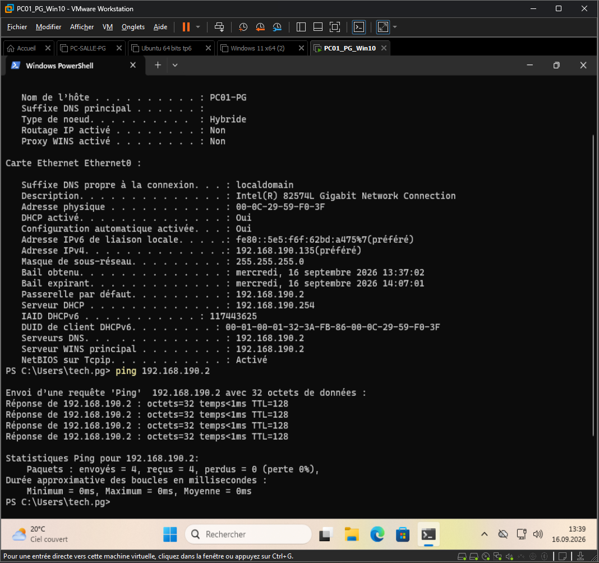

*`ipconfig /all` montre l'adresse `192.168.190.135` de nouveau attribuée, avec un bail DHCP obtenu à 13:37:02 — soit à l'instant même du rescan. `ping 192.168.190.2` répond avec 0 % de perte. L'adresse est identique à celle de l'état de référence, aucune divergence à justifier.*

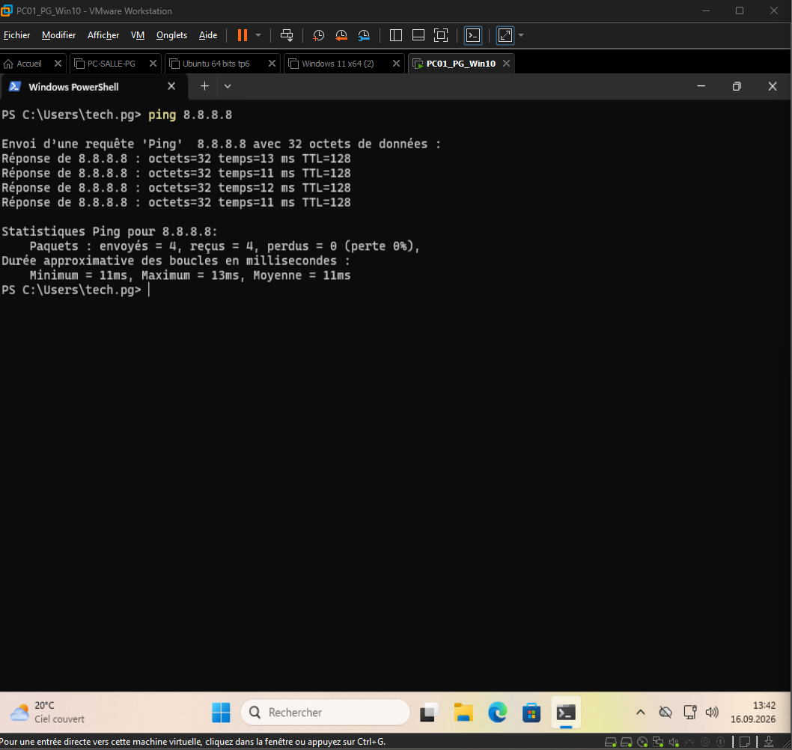

*`ping 8.8.8.8` répond avec 0 % de perte et 11 ms de moyenne. Le maillon 6 — sortie vers Internet — est validé. La chaîne est vérifiée de bout en bout, et non jusqu'au premier signe encourageant.*

### 4.5 Synthèse du ticket 042

| | |
|---|---|
| **Cause identifiée** | Périphérique réseau Intel 82574L désinstallé de l'inventaire système |
| **Correction appliquée** | Gestionnaire de périphériques > Action > Rechercher les modifications sur le matériel |
| **Preuve de résolution** | Carte présente sans erreur, IP obtenue par DHCP, passerelle et Internet joignables à 0 % de perte |
| **Durée d'intervention** | Environ 30 minutes |
| **Hypothèses écartées** | Attaque DDoS (mécanisme incompatible avec le symptôme), lien physique déconnecté (vérifié), configuration IP / DHCP / DNS / pare-feu (sans objet, maillon antérieur cassé) |

**Observation transposable.** La gravité d'une panne de pilote dépend de l'origine du pilote. Pilote intégré à Windows : réparation en un rescan. Pilote fabricant supprimé : il faut le récupérer ailleurs, ce qui suppose un accès réseau — précisément ce dont on ne dispose plus quand c'est la carte réseau qui est touchée. D'où l'intérêt, en entreprise, de maintenir une bibliothèque de pilotes hors ligne pour le parc.

---

## 5. Ticket 2026-043 — Poste anormalement lent au démarrage

| | |
|---|---|
| **N° de ticket** | TICKET-2026-043 |
| **Date** | 16.09.2026, 14h06 – 15h04 |
| **Poste** | PC01-PG |
| **Criticité** | Moyenne — poste fonctionnel mais inutilisable pendant plusieurs minutes après allumage |
| **Catégorie** | Programmes de démarrage indésirables |

### 5.1 Étape 1 — Identifier et quantifier le problème

**Signalement utilisateur :** « Le poste met plusieurs minutes avant d'être utilisable le matin. »

Une plainte de lenteur n'est pas mesurable telle quelle. La première action consiste donc à la transformer en chiffres, avant et après.

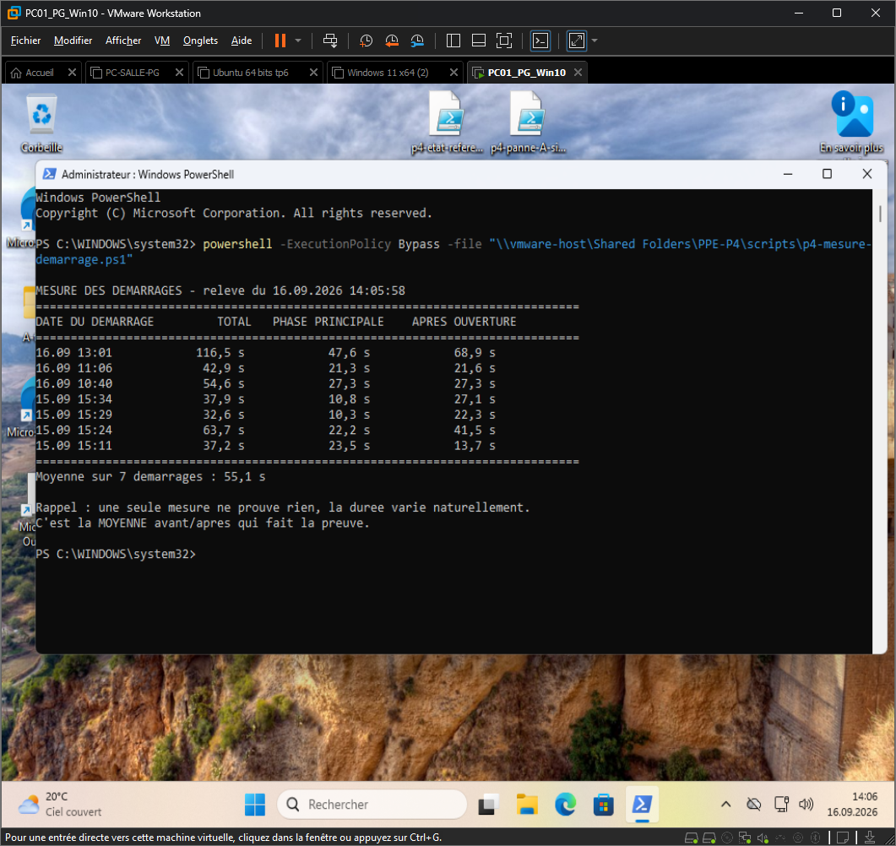

*Relevé des durées de démarrage issu du journal `Diagnostics-Performance`, événement 100, que Windows écrit automatiquement à chaque démarrage. Trois valeurs par démarrage : durée totale, phase principale (noyau, pilotes, services) et phase postérieure à l'ouverture de session. Moyenne de référence retenue : **44,8 s** au total, dont **25,6 s** après ouverture de session.*

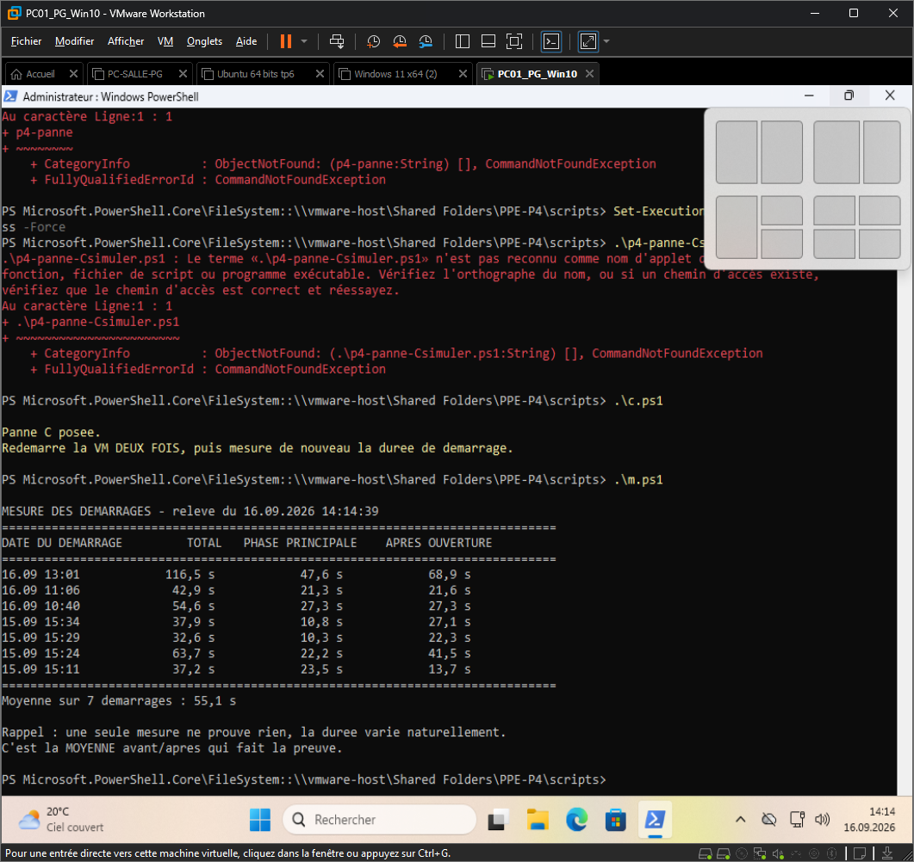

*Confirmation de la mise en place du scénario de panne à 14h14.*

### 5.2 Mesure sous panne

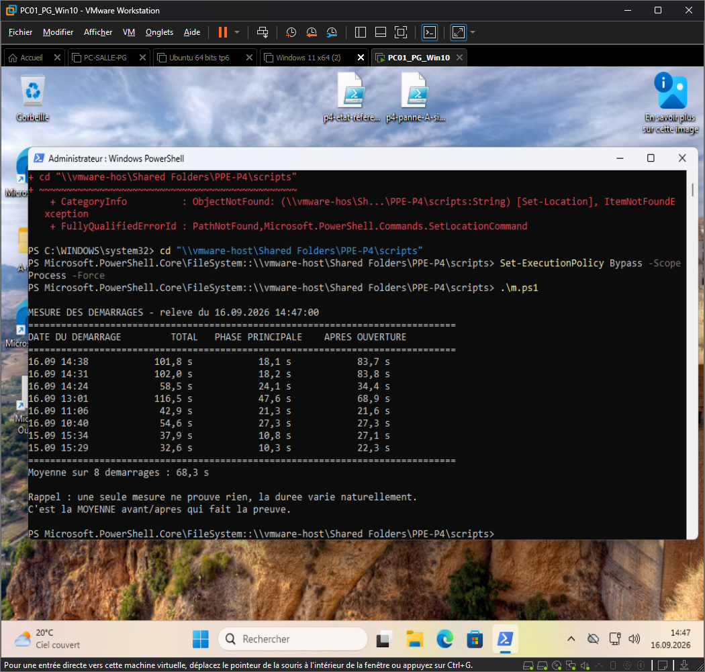

*Trois démarrages après mise en place du scénario. Les deux derniers — 14:31 et 14:38 — donnent 102,0 s et 101,8 s au total, soit un écart de 0,2 s entre deux mesures indépendantes. Cette reproductibilité écarte l'hypothèse d'une variation fortuite. Le démarrage de 14:24 (58,5 s) est plus bas car le poste a été redémarré avant la fin de la charge : Windows a clos sa mesure prématurément.*

**Comparaison chiffrée :**

| Indicateur | Poste sain | Poste en panne | Écart |
|---|---|---|---|
| Durée totale | 44,8 s | 101,9 s | **× 2,3** |
| Phase principale | ≈ 19 s | 18,2 s | **inchangée** |
| Phase après ouverture de session | 25,6 s | 83,8 s | **× 3,3** |

La ligne du milieu est la plus instructive : **la phase principale n'a pas bougé**. Noyau, pilotes et services démarrent aussi vite qu'avant. Tout le retard est concentré après l'ouverture de session. Cela localise la panne sans ambiguïté et écarte d'emblée les pistes matériel, disque et services système — maillons 1, 2, 3 et 5 de la chaîne « poste lent ».

### 5.3 Étape 3 — Test des hypothèses

**Observation directe de l'état du poste.**

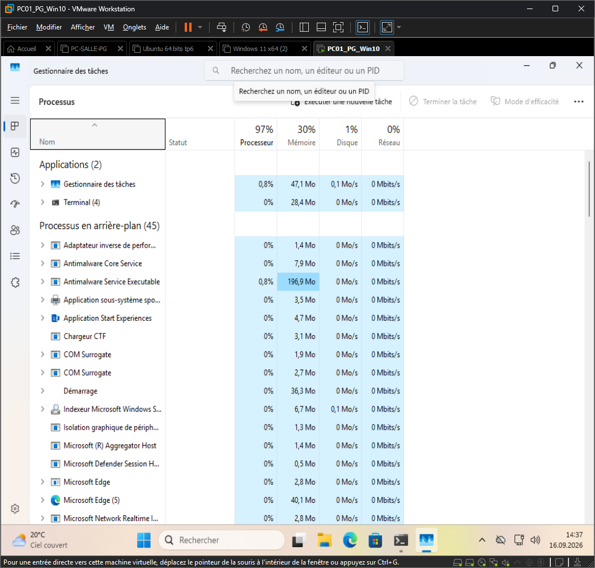

*Gestionnaire des tâches immédiatement après l'ouverture de session : 97 % d'utilisation du processeur alors qu'aucune application n'a été lancée par l'utilisateur. Le symptôme est visible en direct, sans outil spécialisé.*

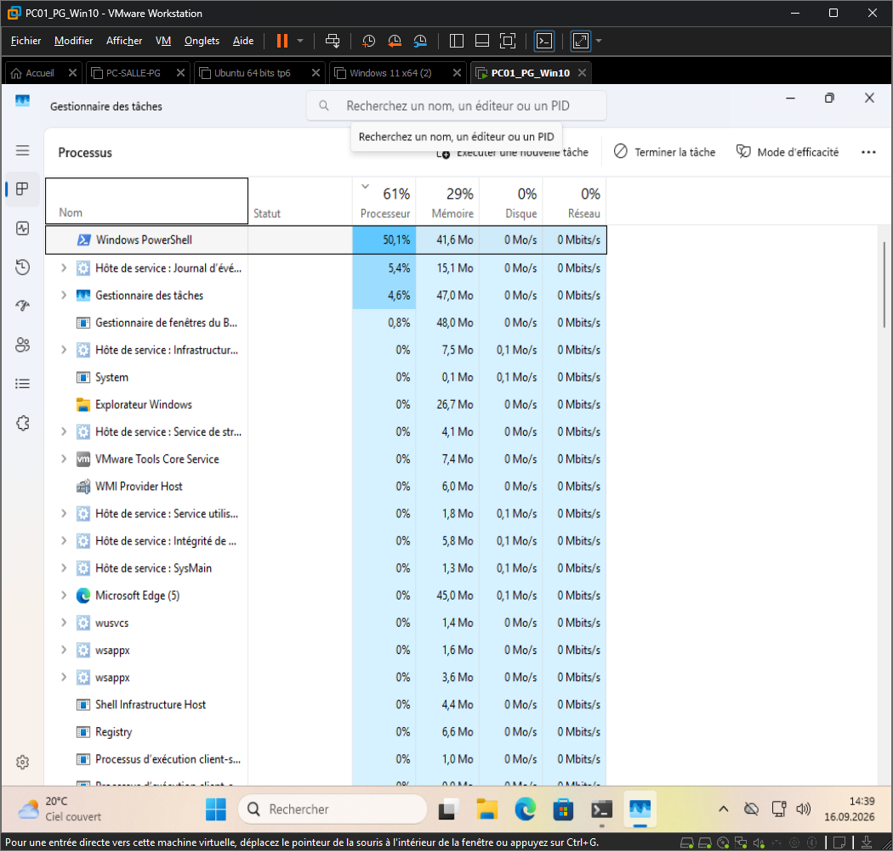

*Après tri de la colonne Processeur, un processus **Windows PowerShell** occupe 50,1 % du processeur. Aucun script n'a été lancé manuellement : ce processus a donc été démarré automatiquement. Le gestionnaire des tâches nomme le programme exécuté, mais pas ce qui l'a lancé.*

**Inventaire des programmes de démarrage.**

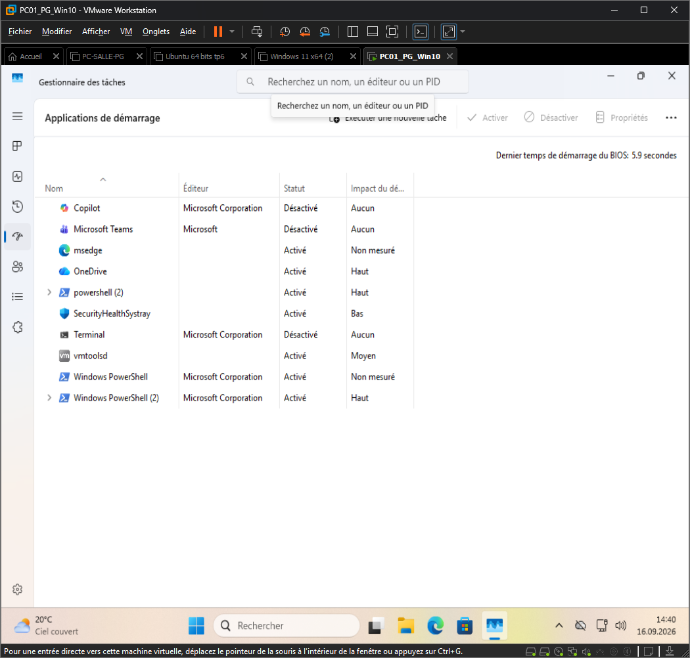

*Onglet Applications de démarrage : trois entrées PowerShell — `powershell (2)`, `Windows PowerShell` et `Windows PowerShell (2)` — dont deux classées en impact **Haut**. Sur un poste bureautique, trois consoles lancées automatiquement à l'ouverture de session est anormal. En haut à droite, « Dernier temps de démarrage du BIOS : 5,9 secondes » écarte toute cause firmware ou matérielle — maillon 1 de la chaîne validé.*

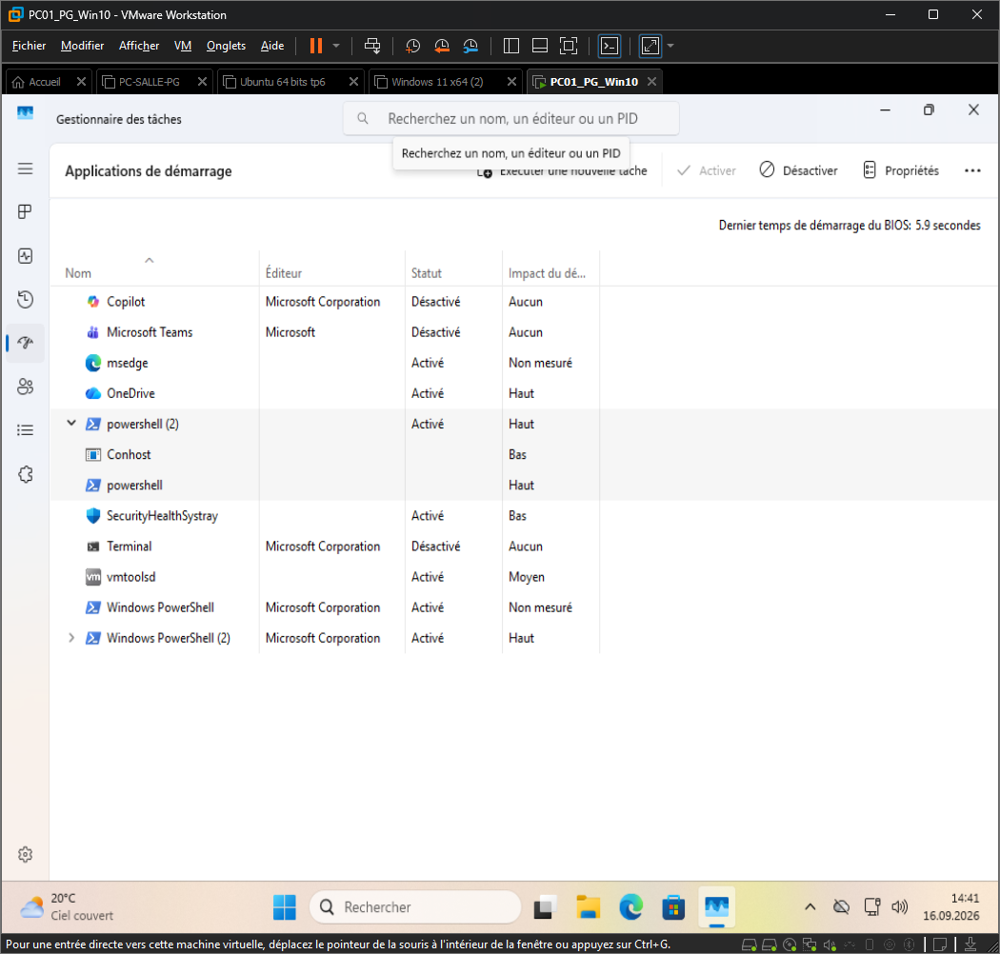

*Groupes dépliés. Le gestionnaire des tâches regroupe les entrées par programme exécuté et non par entrée de démarrage : il affiche « Windows PowerShell » sans révéler le nom réel des entrées ni la commande exécutée. Cet outil montre l'effet, pas la source.*

**Remontée à la source : le registre.**

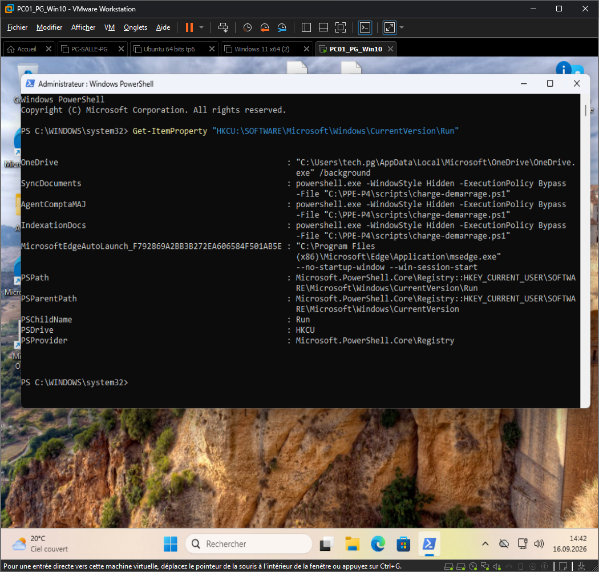

*`Get-ItemProperty "HKCU:\SOFTWARE\Microsoft\Windows\CurrentVersion\Run"` révèle trois entrées — `SyncDocuments`, `AgentComptaMAJ`, `IndexationDocs` — qui lancent toutes la même commande : `powershell.exe -WindowStyle Hidden -ExecutionPolicy Bypass -File "C:\PPE-P4\scripts\charge-demarrage.ps1"`. Les deux autres entrées, `OneDrive` et `MicrosoftEdgeAutoLaunch`, sont des composants légitimes du poste.*

Trois caractéristiques de ces entrées méritent d'être relevées, car elles correspondent aux techniques de persistance d'un logiciel indésirable :

- **des noms crédibles** évoquant des outils métier, qui n'éveillent aucun soupçon dans une liste ;
- **`-WindowStyle Hidden`**, qui empêche toute fenêtre de s'afficher : l'utilisateur ne voit rien ;
- **la clé `Run` de l'utilisateur**, emplacement de persistance classique que personne ne consulte jamais.

**Confirmation chiffrée dans les journaux.**

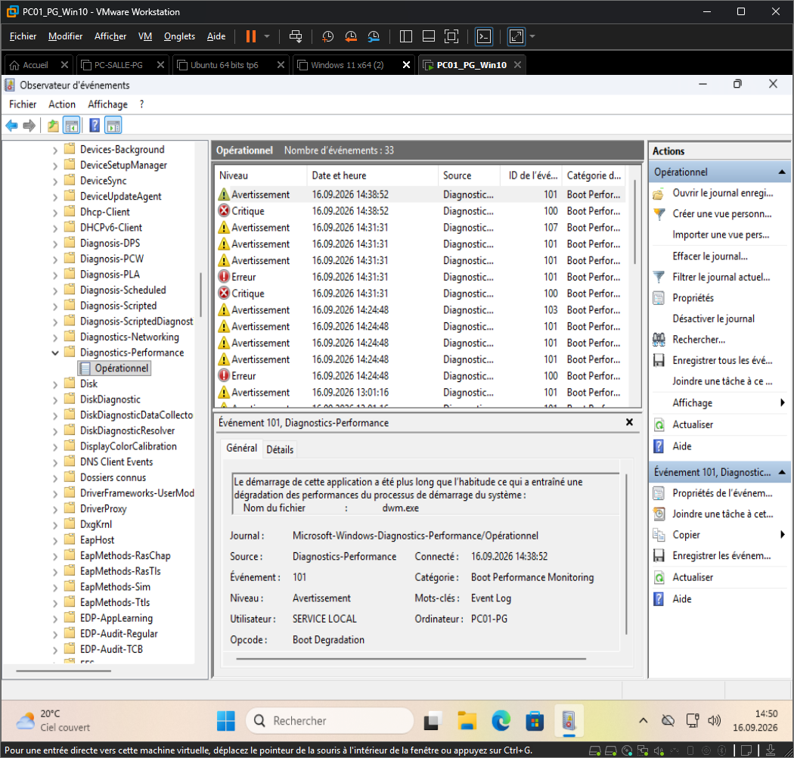

*Le premier événement 101 consulté nomme `dwm.exe`, le Desktop Window Manager — le composant qui dessine le bureau et les fenêtres. Ce n'est pas le coupable mais une victime : il a démarré lentement parce que le processeur était saturé par autre chose. Le journal signale ce qui a été lent, pas nécessairement ce qui a causé la lenteur. S'arrêter à cet événement conduirait à une fausse piste.*

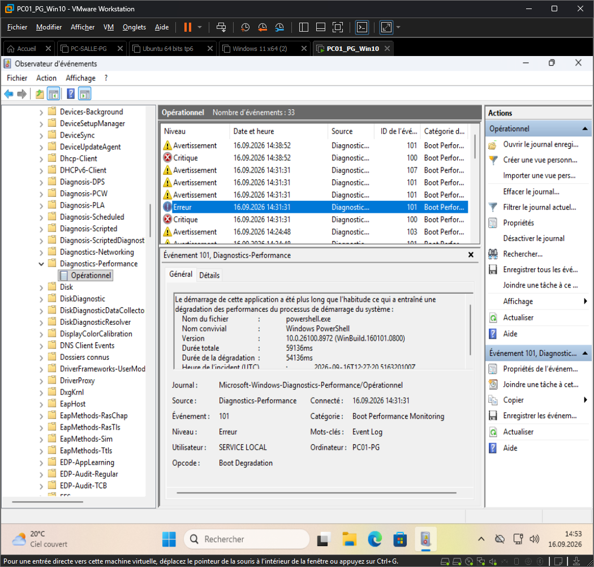

*Événement 101 du 16.09.2026 à 14:31:31, niveau **Erreur** — le seul de ce niveau, les autres n'étant que des avertissements. Nom du fichier : `powershell.exe`. Durée totale : **59 136 ms**. Durée de la dégradation : **54 136 ms**. Windows désigne lui-même le responsable et chiffre le préjudice.*

À ce stade, trois preuves indépendantes se recoupent : la mesure globale (× 3,3 sur la phase après ouverture), le nom du responsable (événement 101, 54 136 ms), et la source de son lancement (les trois entrées de la clé `Run`).

### 5.4 Étapes 4 et 5 — Correction et vérification

**Correction en deux temps.** La désactivation est immédiate et réversible ; la suppression est définitive. En intervention réelle on désactive, on vérifie que le poste va mieux, puis on nettoie. En cas d'erreur de diagnostic, on réactive sans rien avoir détruit.

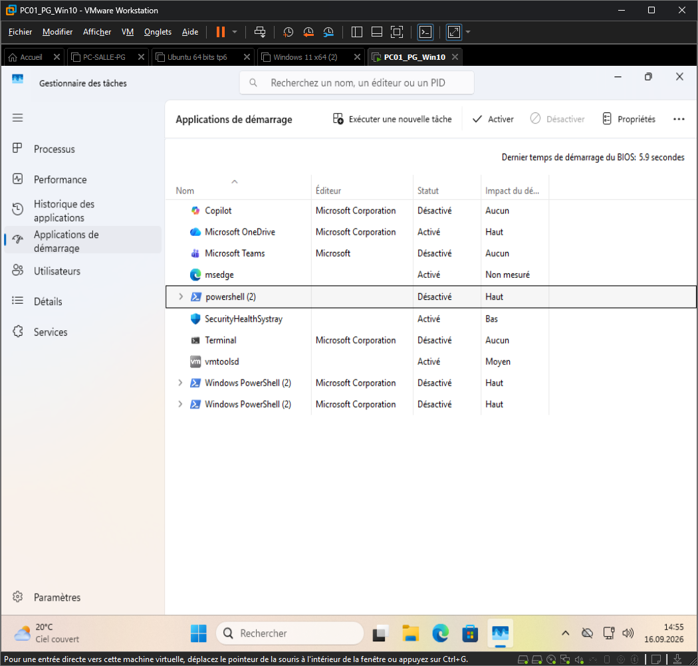

*Les trois entrées PowerShell passent au statut « Désactivé ». `Microsoft OneDrive`, `msedge`, `SecurityHealthSystray` et `vmtoolsd` restent activés : ce sont des composants légitimes du poste. Un dépannage qui désactive tout au passage traite le symptôme au prix de la fonctionnalité.*

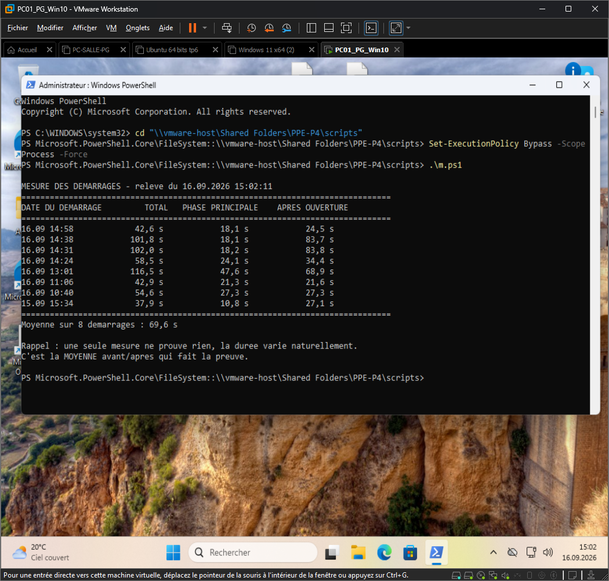

*Démarrage du 16.09 à 14:58, après correction : 42,6 s au total, 18,1 s de phase principale, 24,5 s après ouverture de session. Les valeurs reviennent au niveau de l'état de référence, et sont même très légèrement meilleures — trois programmes qui n'avaient pas lieu d'être ont disparu du démarrage.*

**Bilan chiffré de la correction :**

| Indicateur | Poste sain | En panne | Après réparation | Gain |
|---|---|---|---|---|
| Durée totale | 44,8 s | 101,9 s | **42,6 s** | **− 59,3 s (− 58 %)** |
| Phase principale | ≈ 19 s | 18,2 s | 18,1 s | — |
| Après ouverture de session | 25,6 s | 83,8 s | **24,5 s** | **− 59,3 s (− 71 %)** |

**Nettoyage.**

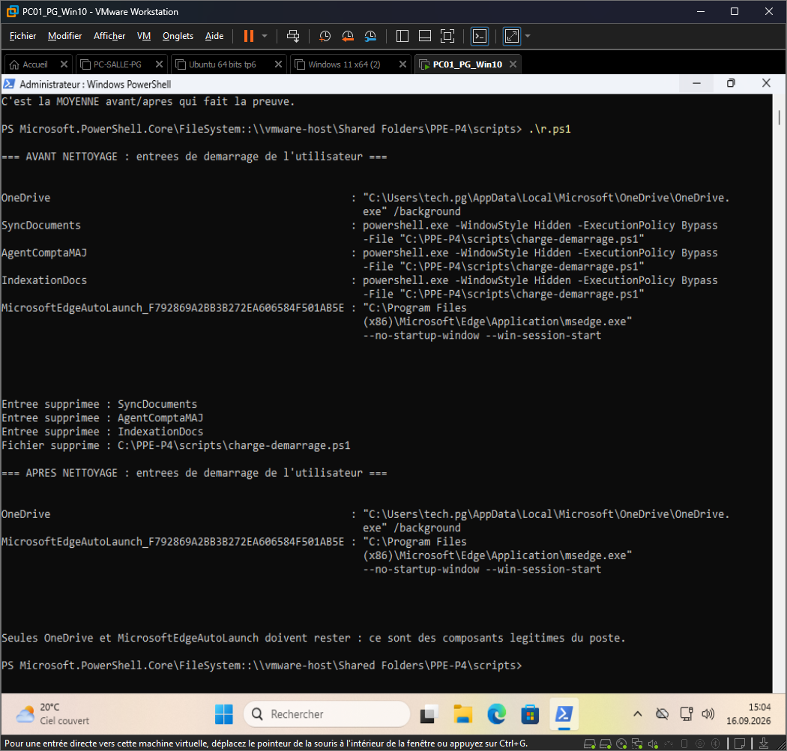

*Sortie avant/après du script de nettoyage : suppression des trois entrées `SyncDocuments`, `AgentComptaMAJ` et `IndexationDocs`, puis du fichier `C:\PPE-P4\scripts\charge-demarrage.ps1`. Après opération, seules `OneDrive` et `MicrosoftEdgeAutoLaunch` subsistent dans la clé `Run`.*

Le critère de résolution effective ne se limite pas à la disparition du symptôme. Un poste rendu avec trois entrées désactivées mais toujours présentes, et le script correspondant toujours sur le disque, est un poste dont la panne peut revenir dès que quelqu'un les réactive.

### 5.5 Synthèse du ticket 043

| | |
|---|---|
| **Cause identifiée** | Trois entrées de démarrage dans `HKCU\...\Run` lançant un script PowerShell masqué et consommateur de processeur |
| **Correction appliquée** | Désactivation via le gestionnaire des tâches, puis suppression des entrées et du script |
| **Preuve de résolution** | Durée de démarrage revenue de 101,9 s à 42,6 s ; phase après ouverture de 83,8 s à 24,5 s ; clé `Run` nettoyée |
| **Durée d'intervention** | Environ 60 minutes, dont une large part en attente de redémarrages |
| **Hypothèses écartées** | Firmware lent (BIOS à 5,9 s), phase noyau/pilotes (inchangée à 18 s), services lents, disque plein (40,7 Go libres), mémoire saturée (5,4 Go libres), `dwm.exe` (victime et non cause) |

---

## 6. Synthèse des hypothèses testées

| Panne | Hypothèse | Test effectué | Résultat | Verdict |
|---|---|---|---|---|
| A | Bluetooth défaillant | Observation du symptôme avant/après | Message présent en permanence, VM sans puce Bluetooth | **Écartée** — sans lien |
| A | H1 — document bloqué en file d'attente | Analyse du message d'erreur du journal | Le service ne démarre pas, il ne se bloque pas | **Écartée** |
| A | H2 — pilote d'imprimante en conflit | Analyse du même message | Les pilotes se chargent après le démarrage du service | **Écartée** |
| A | H3 — service désactivé | `sc qc Spooler` | `START_TYPE : 2 AUTO_START` | **Écartée** |
| A | H4 — dépendance à l'arrêt | `sc qc Spooler`, onglet Dépendances | `RPCSS` et `HTTP` opérationnels | **Écartée** |
| A | H5 — chemin du binaire altéré | `sc qc` + `Test-Path` | `spoolsvc.exe` déclaré, fichier inexistant | **✅ Confirmée** |
| B | Attaque DDoS | Raisonnement sur le mécanisme | Un DDoS sature, il ne supprime pas un périphérique | **Écartée** |
| B | Mise à jour Windows défaillante | Non retenue après identification de la cause | — | **Non retenue** |
| B | Lien physique déconnecté | Paramètres VMware de la carte | Connecté, NAT actif | **Écartée** |
| B | Configuration IP / DHCP / DNS / pare-feu | Non testées | Maillon antérieur cassé, vérifications sans objet | **Sans objet** |
| B | Périphérique absent de l'inventaire | Gestionnaire de périphériques | Carte Intel 82574L disparue des cartes réseau | **✅ Confirmée** |
| C | Firmware lent | Gestionnaire des tâches | BIOS à 5,9 s | **Écartée** |
| C | Phase noyau et pilotes ralentie | Événement 100, colonne phase principale | 18,2 s en panne contre ≈ 19 s sain | **Écartée** |
| C | Service lent au démarrage | Événements 103 | Pas de service en cause | **Écartée** |
| C | Disque plein | `Get-Volume` | 40,7 Go libres, 69 % | **Écartée** |
| C | Mémoire saturée | Gestionnaire des tâches | 5,4 Go libres sur 7,8 Go | **Écartée** |
| C | `dwm.exe` responsable | Événement 101 | Composant ralenti par la saturation, non cause | **Écartée** |
| C | Programmes de démarrage indésirables | Événement 101 + clé `Run` | `powershell.exe`, 54 136 ms, 3 entrées | **✅ Confirmée** |

**18 hypothèses formulées, 3 confirmées, 14 écartées avec preuve, 1 sans objet.**

---

## 7. Problèmes rencontrés pendant l'intervention

### P1 — Faux symptôme : échec des connexions Bluetooth

**Contexte.** Au moment de constater la panne A, Windows affichait « Connexion impossible » pour le Bluetooth et le Miracast, en plus de l'erreur d'impression.

**Explication.** La machine de test est virtuelle et VMware n'émule aucune puce Bluetooth : Windows ne trouve jamais d'adaptateur, quel que soit l'état du poste. Le message était présent avant la panne et l'est resté après réparation.

**Traitement.** Symptôme écarté dès l'étape d'identification et documenté comme hypothèse non retenue.

**Enseignement.** Un utilisateur signale souvent plusieurs anomalies à la fois. Trier ce qui est lié de ce qui ne l'est pas fait partie de l'étape 1 : partir sur le mauvais symptôme coûte plus cher que la panne.

### P2 — Événement 7000 antérieur, source de confusion possible

**Contexte.** Après réparation et redémarrage, le journal Système filtré sur les erreurs affichait toujours un événement 7000 lié au spouleur.

**Explication.** Cet événement datait de 11:04:34, soit du démarrage précédant l'intervention. Le redémarrage de validation a eu lieu à 12:57:16. L'Observateur d'événements conserve l'historique : la présence d'une erreur ancienne ne signifie pas que la panne persiste.

**Traitement.** L'horodatage du redémarrage de validation a été précisé sous la capture concernée.

**Enseignement.** Une preuve par absence d'erreur n'a de valeur que si la fenêtre temporelle est explicite.

### P3 — Case « Tenter de supprimer le pilote » absente

**Contexte.** La simulation de la panne B prévoyait de désinstaller la carte réseau en supprimant son paquet pilote. La boîte de dialogue ne proposait pas cette option.

**Explication.** Windows ne propose la suppression du paquet pilote que pour les pilotes tiers installés par un fabricant. Le pilote de la carte Intel 82574L est intégré au système (« in-box ») et ne peut pas être retiré du magasin de pilotes.

**Traitement.** La simulation a été conservée : la désinstallation du périphérique suffisait à produire le symptôme recherché.

**Enseignement.** La difficulté d'une panne de pilote dépend de l'origine du pilote. Intégré : rescan suffisant. Fabricant : récupération externe nécessaire — problématique quand la panne concerne justement la carte réseau.

### P4 — Capture de la simulation oubliée

**Contexte.** La capture de la boîte de dialogue de désinstallation n'a pas été prise avant validation.

**Traitement.** Le pilote a été réinstallé par un rescan matériel, puis la désinstallation rejouée, capture prise avant validation.

**Enseignement.** La capture se prend **pendant** la manipulation, pas après. Ici l'étape était rejouable sans conséquence ; sur un poste de production, elle ne l'aurait pas été.

### P5 — Perte du copier-coller et du glisser-déposer entre l'hôte et la VM

**Contexte.** En cours d'intervention, le transfert de fichiers par glisser-déposer et le copier-coller de commandes depuis la machine hôte ont cessé de fonctionner. Ces fonctions marchaient en début de session.

**Explication.** Elles sont assurées par **VMware Tools**, l'ensemble de pilotes et de services installé à l'intérieur de la machine virtuelle. Son service `VMTools` gère le presse-papiers partagé, le glisser-déposer et l'intégration de la souris. Lorsqu'il se bloque — ce qui arrive après une session longue ou de nombreux redémarrages — l'intégration hôte/invité est perdue sans aucun message d'erreur.

**Démarche appliquée, du plus simple au plus complexe :**

1. Redémarrage de la machine virtuelle — sans effet.

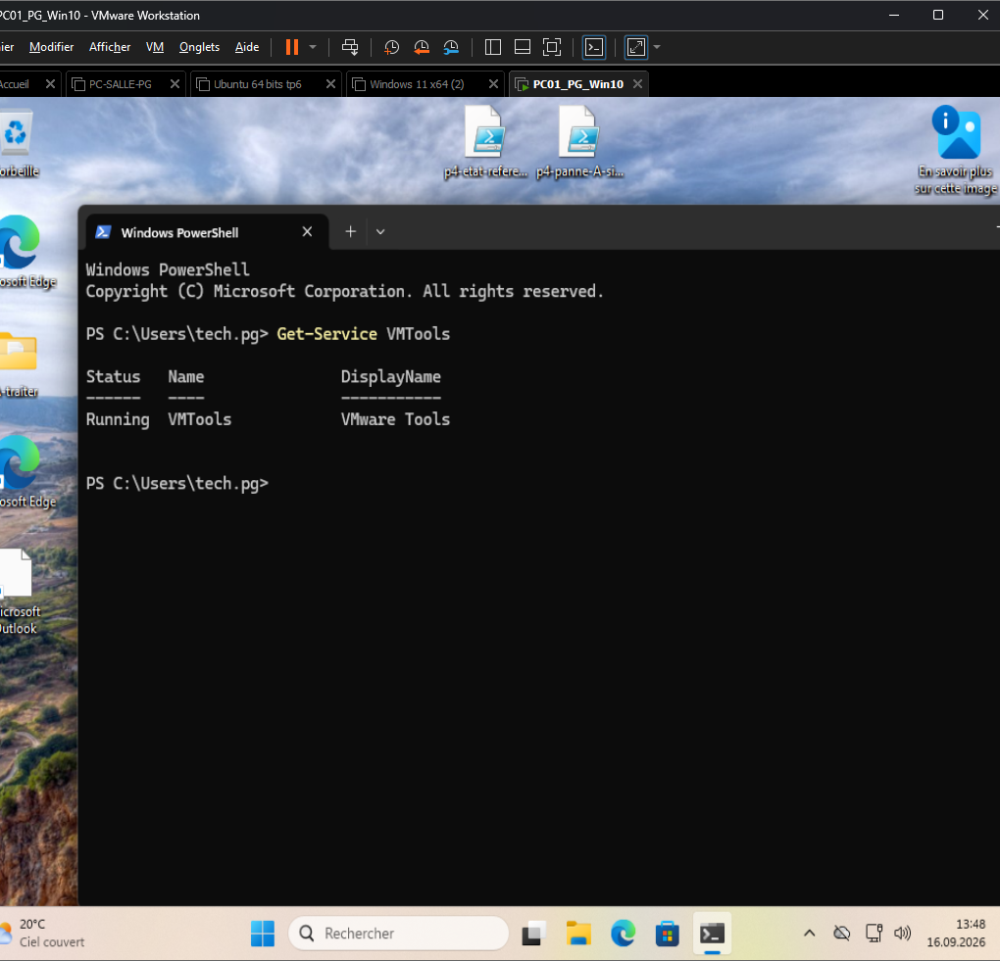

*2. Vérification de l'état du service dans l'invité : `Get-Service VMTools` renvoie `Running`. Le service fonctionne, la cause est donc ailleurs.*

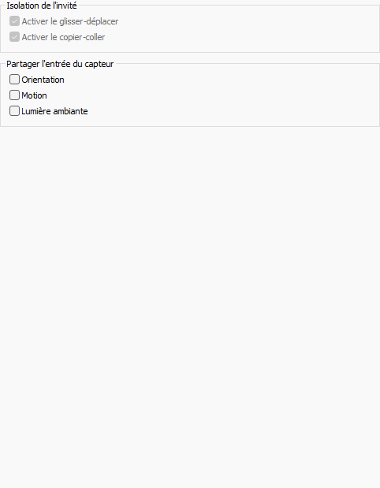

*3. Vérification des autorisations côté hyperviseur : « Activer le glisser-déplacer » et « Activer le copier-coller » sont cochés. Les options apparaissent grisées car la machine est sous tension, VMware verrouillant ces réglages pendant l'exécution. L'autorisation n'est donc pas en cause non plus.*

4. Solution de contournement retenue : un **dossier partagé** VMware.

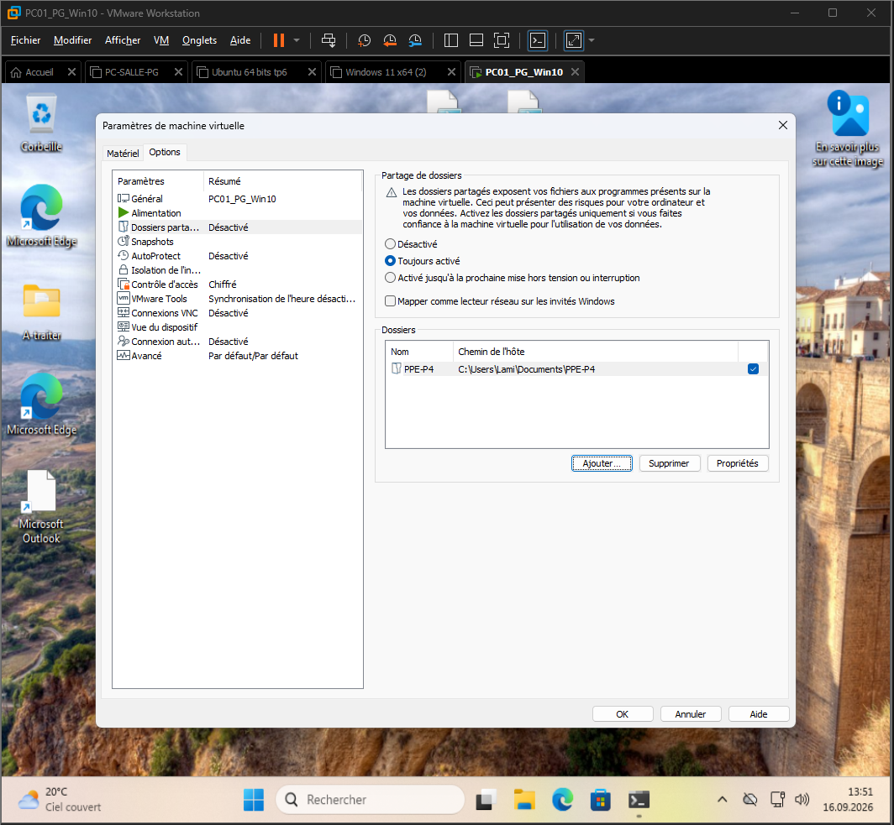

*Le dossier `C:\Users\Lami\Documents\PPE-P4` de la machine hôte est partagé vers la machine virtuelle sous le nom `PPE-P4`, en mode « Toujours activé ». Il devient accessible depuis l'invité à l'adresse `\\vmware-host\Shared Folders\PPE-P4`.*

**Pourquoi cette solution est préférable au glisser-déposer.** Le dossier partagé emprunte un canal différent du presse-papiers, survit aux redémarrages, et supprime purement et simplement l'étape de copie : les scripts restent sur l'hôte et la machine virtuelle les lit directement. Un seul exemplaire de chaque fichier, donc aucun risque de travailler sur une version périmée.

**Point de sécurité relevé.** Le partage donne à la machine virtuelle un accès en écriture à un dossier de la machine hôte — VMware l'indique explicitement dans l'avertissement de la fenêtre de configuration. C'est acceptable dans ce contexte, mais à proscrire sur une VM servant à manipuler des fichiers suspects : le partage constitue alors un pont direct vers la machine hôte. C'est d'ailleurs la raison d'être des options d'isolation de l'invité.

**Enseignement.** L'intégration hôte/invité n'est pas une propriété de la machine virtuelle mais un service applicatif qui tourne dedans, et qui peut tomber comme n'importe quel service. La démarche de diagnostic a été rigoureusement la même que pour la panne A : identifier le composant responsable de la fonction perdue, vérifier son état, puis remonter vers sa configuration.

### P6 — Droits insuffisants pour lire le journal de performances

**Contexte.** Les premières tentatives de lecture du journal `Diagnostics-Performance` échouaient avec le message « Tentative d'exécution d'une opération non autorisée ».

**Explication.** Ce journal contient des données de performance portant sur l'ensemble du système et non sur la seule session courante. Windows en réserve la lecture aux administrateurs, comme le journal de sécurité. La console utilisée n'était pas élevée — repérable à sa barre de titre, qui indique « Windows PowerShell » et non « Administrateur : Windows PowerShell ».

**Traitement.** Relance depuis une console élevée.

**Enseignement.** Le message d'erreur nommait la cause réelle ; il suffisait de le lire jusqu'au bout. Par ailleurs, la barre de titre est un indicateur fiable du niveau de privilège de la console.

### P7 — Politique d'exécution PowerShell réinitialisée à chaque fenêtre

**Contexte.** Après chaque redémarrage, les scripts étaient de nouveau bloqués : « l'exécution de scripts est désactivée sur ce système ».

**Explication.** Par défaut, Windows bloque l'exécution des scripts PowerShell, mesure de sécurité contre les scripts malveillants. La commande `Set-ExecutionPolicy Bypass -Scope Process -Force` lève cette restriction **pour la fenêtre en cours uniquement** ; la restriction revient dès la fermeture de la console.

**Traitement.** Application de la commande au début de chaque session de travail.

**Enseignement.** La portée `Process` est justement le bon choix : elle évite d'abaisser durablement le niveau de sécurité de la machine pour un besoin ponctuel. Le comportement n'est pas un défaut, c'est la mesure de sécurité qui fonctionne comme prévu.

### P8 — Erreurs de frappe répétées sur les chemins réseau

**Contexte.** De nombreuses tentatives ont échoué sur des fautes de frappe : `vmare-host` puis `vmware-hos` au lieu de `vmware-host`, `Shared Folder` au lieu de `Shared Folders`, `p4-mesure-démarrage.ps1` avec un accent au lieu de `p4-mesure-demarrage.ps1`, `simulter` au lieu de `simuler`. Le copier-coller depuis l'hôte étant hors service (P5), chaque commande devait être saisie intégralement à la main.

**Traitement.** Trois mesures ont résolu le problème :

- utilisation de la **flèche ↑**, qui rappelle l'historique des commandes — y compris celles des sessions précédentes ;
- utilisation de la touche **Tab**, qui complète automatiquement les noms de fichiers ;
- création de **copies à noms courts** des scripts (`m.ps1`, `c.ps1`, `r.ps1`), réduisant la saisie à six caractères.

**Enseignement.** En ligne de commande, on ne retape jamais une commande longue. Historique et complétion ne sont pas des commodités : ce sont les outils qui évitent cette catégorie entière d'erreurs. Deuxième point retenu : **les noms de fichiers ne doivent pas contenir d'accents**, précisément pour cette raison — c'est pourquoi les scripts du projet sont nommés `p4-mesure-demarrage.ps1` et non `p4-mesure-démarrage.ps1`.

### P9 — Mesure de démarrage indisponible immédiatement après redémarrage

**Contexte.** Plusieurs relevés successifs ne faisaient apparaître aucun nouveau démarrage, laissant croire à un échec de manipulation.

**Explication.** Windows n'écrit pas l'événement 100 au moment où le bureau s'affiche. Il attend que le système se stabilise — que les programmes de démarrage aient terminé — puis calcule la durée et l'enregistre, soit 2 à 5 minutes après l'ouverture de session. Sous panne C, le phénomène était amplifié : les trois scripts tournaient pendant 2 min 30 après la connexion. Redémarrer pendant cette fenêtre empêche Windows de clore sa mesure.

**Traitement.** Séquence fixée : redémarrer, ouvrir la session, **attendre 4 à 5 minutes sans rien faire**, puis mesurer. Le démarrage de 14:24 (58,5 s au lieu de ≈ 102 s) est la trace de ce phénomène et a été signalé comme tel dans le ticket.

**Enseignement.** Un outil de mesure a sa propre latence. Confondre « la mesure n'est pas encore disponible » avec « la manipulation a échoué » conduit à refaire inutilement des opérations correctes.

---

## 8. Ce que cette intervention m'a appris

Cette section rassemble les méthodes et réflexes acquis pendant le projet. Elle sert autant de justification de la démarche que de mémo réutilisable.

### 8.1 Une méthode vaut mieux qu'une intuition

La difficulté du diagnostic n'est pas de connaître les pannes par cœur, mais de savoir **produire des hypothèses** quand on ne sait pas par où commencer. La méthode retenue — décomposer la fonction en panne en maillons successifs, du plus physique au plus logiciel, et tester dans l'ordre — remplace l'intuition par un parcours systématique. Les trois chaînes établies en section 2.2 (réseau, service, démarrage) sont directement réutilisables.

Elle a un effet mesurable : lors de la panne B, le maillon 2 étant cassé, les maillons 3 à 7 devenaient sans objet. Trois vérifications inutiles évitées, et une conclusion atteinte plus vite.

### 8.2 Une panne écartée vaut une panne trouvée

Chaque hypothèse éliminée réduit le champ de recherche. Sur 18 hypothèses formulées, 14 ont été écartées — et c'est ce travail, autant que les 3 causes confirmées, qui constitue le diagnostic. Encore faut-il **écarter avec une preuve** : « ce n'est pas le disque » n'a aucune valeur, « 40,7 Go libres, capture à l'appui » en a une.

### 8.3 Sans état de référence, il n'y a pas de diagnostic

Le chemin `C:\WINDOWS\System32\spoolsvc.exe` paraît parfaitement normal. C'est uniquement la comparaison avec la valeur relevée à froid qui a révélé le caractère surnuméraire. **Une panne de configuration ne ressemble jamais à une panne** : elle ressemble à une configuration.

Corollaire : relever l'état sain **avant** d'intervenir n'est pas une formalité administrative, c'est ce qui rend le diagnostic possible et la réparation démontrable.

### 8.4 Lire les messages d'erreur littéralement

L'événement 7000 disait « Le fichier spécifié est introuvable » — pas « le service a planté », pas « accès refusé ». Cette formulation précise éliminait à elle seule trois hypothèses sur cinq. De même, « Tentative d'exécution d'une opération non autorisée » (P6) nommait exactement la cause.

Un message d'erreur est rarement vague ; c'est la lecture qui l'est.

### 8.5 Trier le bruit dans les journaux

Le journal Système contenait 972 événements. Le filtrage par niveau en a isolé 16, le tri par horodatage autour de l'incident 4, dont un seul pertinent. Les `TPM-WMI 1796` et `DistributedCOM 10010` sont du bruit permanent, présents depuis des jours.

Le réflexe — filtrer par niveau, puis par fenêtre temporelle autour de l'incident — est ce qui rend un journal exploitable.

### 8.6 Distinguer la victime du coupable

L'événement 101 sur `dwm.exe` désignait un composant ralenti, non la cause du ralentissement. Un journal de performance signale **ce qui a été lent**, pas nécessairement **ce qui a causé la lenteur**. S'arrêter au premier nom trouvé mène à une fausse piste — et à une réparation qui ne répare rien.

### 8.7 Une mesure unique ne prouve rien

Les durées de démarrage du poste sain variaient de 32,6 s à 63,7 s, soit du simple au double. Conclure sur une seule mesure était donc impossible. Ce qui a fait preuve, ce sont deux relevés indépendants séparés de 0,2 s (102,0 s et 101,8 s) : la reproductibilité, pas la valeur isolée.

Corollaire appris en pratique : une valeur aberrante s'écarte **en documentant pourquoi**, jamais en silence.

### 8.8 Vérifier à trois niveaux, pas un seul

Une réparation se démontre à trois niveaux successifs :

1. **la cause est corrigée** — le chemin du binaire est rétabli ;
2. **la fonction est rétablie** — l'utilisateur peut de nouveau imprimer ;
3. **la correction tient dans le temps** — le service repart seul après redémarrage.

Le troisième niveau est celui qu'on saute le plus volontiers, et c'est celui qui évite la réouverture du ticket le lendemain matin.

### 8.9 Réparer sans casser autre chose

Trois entrées de démarrage ont été désactivées ; quatre autres — OneDrive, Edge, SecurityHealthSystray, vmtoolsd — ont été laissées intactes. Un dépannage qui désactive tout au passage traite le symptôme au prix de la fonctionnalité.

De même, désactiver avant de supprimer offre un retour arrière en cas d'erreur de diagnostic. Mais s'arrêter à la désactivation laisse la cause en place : le nettoyage final fait partie de la réparation.

### 8.10 Ce que la panne C apprend sur la sécurité

Les trois entrées créées pour la simulation reproduisent exactement les techniques de persistance d'un logiciel indésirable : des noms crédibles évoquant des outils métier, une exécution masquée par `-WindowStyle Hidden`, et un emplacement — la clé `Run` de l'utilisateur — que personne ne consulte.

Le point marquant : le gestionnaire des tâches ne révélait **ni les noms réels des entrées, ni la commande exécutée**. Seule la consultation directe du registre a donné l'information complète. Un outil graphique montre souvent l'effet ; la source demande de descendre d'un niveau.

### 8.11 Outils retenus et ce que chacun apporte

| Outil | Ce qu'il montre | Sa limite |
|---|---|---|
| Observateur d'événements | L'historique horodaté, avec ID et message précis | Contient énormément de bruit ; exige un filtrage |
| `services.msc` | État et type de démarrage des services | N'affiche pas la configuration complète |
| `sc qc <service>` | Configuration déclarée : binaire, démarrage, dépendances | Ligne de commande, syntaxe particulière |
| Gestionnaire de périphériques | Matériel détecté, codes d'erreur, pilotes | Ne montre pas les périphériques absents sans activer l'affichage correspondant |
| `ipconfig /all` | Configuration IP complète, baux DHCP | Ne dit rien de la connectivité réelle |
| `ping` | Joignabilité effective d'une adresse | Ne dit pas pourquoi ça ne passe pas |
| Gestionnaire des tâches | Consommation en direct, programmes de démarrage | Impact estimé en termes vagues ; regroupe les entrées |
| Journal Diagnostics-Performance | Durées chiffrées, responsables nommés, en millisecondes | Nécessite des droits administrateur ; écrit avec 2 à 5 min de latence |
| Registre (`Run`) | Noms réels des entrées et commandes exécutées | Modification risquée sans sauvegarde |

### 8.12 Identifiants d'événements retenus

| ID | Journal | Signification |
|---|---|---|
| **7000** | Système | Un service n'a pas pu démarrer — le message précise la raison |
| **7043** | Système | Un service ne s'est pas arrêté correctement |
| **30** | Système (source Eventlog) | Démarrage du service de journalisation — repère fiable de l'heure de démarrage du système |
| **100** | Diagnostics-Performance | Durée du démarrage de Windows (total, phase principale, après ouverture de session) |
| **101** | Diagnostics-Performance | Une application a ralenti le démarrage — nom du fichier et durée en ms |
| **102** | Diagnostics-Performance | Un pilote a ralenti le démarrage |
| **103** | Diagnostics-Performance | Un service a ralenti le démarrage |
| **10010** | Système (DistributedCOM) | Composant COM n'ayant pas répondu dans le délai — bruit courant, généralement bénin |
| **1796** | Système (TPM-WMI) | Secure Boot non activé — bruit permanent sur machine virtuelle |

---

## 9. Recommandations préventives

| N° | Recommandation | Panne visée | Justification |
|---|---|---|---|
| R1 | Surveiller les événements 7000 du journal Système sur le parc | A | Un service en échec au démarrage laisse toujours cette trace ; la détecter permet d'intervenir avant l'appel de l'utilisateur |
| R2 | Restreindre les droits d'écriture sur les clés de services du registre | A | L'altération d'une valeur `ImagePath` par un compte standard ne devrait pas être possible |
| R3 | Maintenir une bibliothèque hors ligne des pilotes du parc | B | Une panne de carte réseau empêche de télécharger le pilote qui la réparerait |
| R4 | Restreindre l'accès au Gestionnaire de périphériques pour les comptes standard | B | La désinstallation d'un périphérique par mégarde est une cause fréquente de ticket |
| R5 | Auditer périodiquement les clés `Run` des postes | C | Emplacement de persistance privilégié des programmes indésirables, jamais consulté spontanément |
| R6 | Surveiller les événements 100 et 101 pour détecter les dérives de démarrage | C | Permet de repérer un poste qui se dégrade progressivement, avant la plainte |
| R7 | Séparer compte administrateur et compte utilisateur sur les postes | A, B, C | Les trois pannes ont pu être posées parce que la session courante disposait de droits d'administration |
| R8 | Créer un point de restauration ou un snapshot avant toute intervention | toutes | Transforme une manipulation risquée en manipulation réversible |
| R9 | Relever un état de référence lors de la mise en service d'un poste | toutes | Sans point de comparaison, une panne de configuration est indétectable |

---

## 10. Annexes

### 10.1 Scripts utilisés

| Script | Rôle |
|---|---|
| `p4-etat-reference.ps1` | Relève l'état sain du poste : services critiques, binaire du spouleur, configuration réseau, durées de démarrage, éléments de démarrage, disque et mémoire |
| `p4-panne-A-simuler.ps1` | Simule la panne A en altérant la valeur `ImagePath` du service `Spooler` |
| `p4-mesure-demarrage.ps1` (copie courte : `m.ps1`) | Affiche les durées des derniers démarrages à partir de l'événement 100, avec moyenne |
| `p4-panne-C-simuler.ps1` (copie courte : `c.ps1`) | Simule la panne C en créant trois entrées de démarrage lançant un script consommateur de processeur |
| `p4-panne-C-nettoyer.ps1` (copie courte : `r.ps1`) | Supprime les trois entrées de démarrage et le script associé, avec affichage avant/après |

La panne B n'a pas nécessité de script : la désinstallation du périphérique a été faite manuellement via le Gestionnaire de périphériques, ce qui correspond au geste réel d'un utilisateur ou d'un technicien.

### 10.2 Commandes de diagnostic employées

| Commande | Ce qu'elle apporte |
|---|---|
| `sc.exe qc <service>` | Configuration déclarée d'un service : chemin du binaire, type de démarrage, dépendances, compte utilisé |
| `sc.exe config <service> binPath= "<chemin>"` | Modifie le chemin du binaire d'un service (espace obligatoire après `binPath=`) |
| `Get-Service <nom>` | État courant d'un service |
| `Start-Service <nom>` | Démarre un service |
| `Test-Path "<chemin>"` | Vérifie l'existence d'un fichier — renvoie `True` ou `False` |
| `Get-ItemProperty "<clé de registre>"` | Affiche le contenu d'une clé du registre |
| `Remove-ItemProperty -Path "<clé>" -Name <valeur>` | Supprime une valeur du registre |
| `ipconfig /all` | Configuration IP complète, adresses, baux DHCP, serveurs DNS |
| `ping <adresse>` | Teste la joignabilité d'une adresse et mesure le temps de réponse |
| `Get-NetAdapter` | Liste les cartes réseau avec leur état et leur adresse physique |
| `Get-WinEvent -LogName <journal> -FilterXPath "*[System[EventID=<n>]]"` | Extrait les événements d'un identifiant donné dans un journal |
| `Get-Volume` | Espace disque libre et occupé par volume |
| `Set-ExecutionPolicy Bypass -Scope Process -Force` | Autorise l'exécution de scripts pour la fenêtre en cours uniquement |
| `eventvwr.msc`, `services.msc`, `devmgmt.msc`, `regedit` | Consoles graphiques : journaux, services, périphériques, registre |

### 10.3 Glossaire

| Terme | Définition |
|---|---|
| **Service Windows** | Programme fonctionnant en arrière-plan, sans interface, souvent démarré avant l'ouverture de session |
| **Spouleur (spooler)** | Service `Spooler`, qui met les documents en file d'attente avant envoi à l'imprimante. Sans lui, aucune imprimante n'est disponible |
| **Pilote (driver)** | Logiciel faisant l'interface entre le système et un composant matériel. Sans pilote, le matériel est présent mais inutilisable |
| **Pilote intégré (« in-box »)** | Pilote livré avec Windows et conservé dans le magasin de pilotes ; ne peut pas être supprimé du système |
| **Magasin de pilotes (DriverStore)** | Réserve interne de Windows contenant les paquets de pilotes disponibles pour réinstallation |
| **ImagePath** | Valeur du registre indiquant le fichier exécutable qu'un service doit lancer |
| **Observateur d'événements** | Journal de bord de Windows : chaque démarrage, échec ou incident y laisse une entrée horodatée avec un identifiant |
| **ID d'événement** | Numéro identifiant un type d'événement, utilisable comme clé de recherche universelle |
| **Clé `Run`** | Emplacement du registre listant les programmes lancés à l'ouverture de session |
| **Snapshot (instantané)** | Photo de l'état complet d'une machine virtuelle à un instant donné, permettant un retour arrière immédiat |
| **VMware Tools** | Ensemble de pilotes et services installé dans une machine virtuelle, gérant l'intégration avec la machine hôte : presse-papiers, glisser-déposer, souris, dossiers partagés |
| **WAN Miniport** | Pilotes logiciels utilisés par Windows pour les connexions VPN et modem ; présents indépendamment du matériel |
| **DHCP** | Protocole attribuant automatiquement une adresse IP à une machine pour une durée limitée, appelée bail |
| **Passerelle par défaut** | Équipement par lequel transitent les communications sortant du réseau local |
| **DDoS** | *Distributed Denial of Service* — saturation d'un service par un volume massif de requêtes provenant de nombreuses machines |
| **Politique d'exécution PowerShell** | Réglage de sécurité déterminant si les scripts PowerShell peuvent s'exécuter |
| **Élévation de privilèges** | Exécution d'un programme avec les droits d'administrateur ; visible dans la barre de titre de la console |

### 10.4 Chronologie de l'intervention

| Heure | Événement |
|---|---|
| 10h39 | Création du dossier de travail |
| 10h40 | Snapshot `P4-etat-sain-avant-pannes` |
| 10h44 | Relevé de l'état de référence |
| 11h02 | Mise en place de la panne A |
| 11h04 | Premier démarrage en panne — événement 7000 enregistré |
| 11h06 | Constat du symptôme côté utilisateur |
| 11h17 | Formulation des hypothèses |
| 11h29 | `sc qc` — chemin altéré identifié |
| 11h33 | `Test-Path` — absence du fichier confirmée |
| 11h39 | Correction par `sc config`, service redémarré |
| 12h57 | Redémarrage de validation |
| 13h02 | Service `Running` confirmé après redémarrage |
| 13h13 | Mise en place de la panne B |
| 13h30 | Vérification du lien physique côté VMware |
| 13h33 | Constat de l'absence de la carte dans l'inventaire |
| 13h37 | Rescan matériel — pilote réinstallé, bail DHCP obtenu |
| 13h42 | Sortie Internet vérifiée |
| 13h48 – 14h00 | Incident VMware Tools et mise en place du dossier partagé |
| 14h06 | Mesure de référence des démarrages |
| 14h14 | Mise en place de la panne C |
| 14h24, 14h31, 14h38 | Démarrages sous panne |
| 14h37 – 14h53 | Diagnostic : processus, applications de démarrage, registre, événements 101 |
| 14h55 | Désactivation des trois entrées |
| 14h58 | Redémarrage de validation |
| 15h02 | Mesure après réparation — 42,6 s |
| 15h04 | Nettoyage du registre et suppression du script |

### 10.5 Index des captures

| Fichier | Contenu |
|---|---|
| `01-snapshot-cree.png` | Snapshot de sécurité |
| `02a/b/c-etat-reference.png` | État de référence du poste sain |
| `03a-symptome-spouleur.png` | Symptôme panne A |
| `03b-faux-symptome-bluetooth.png` | Symptôme parasite écarté |
| `04a-journal-systeme-erreur.png` | Tri du journal Système |
| `04b-event-7000-spouleur.png` | Événement 7000 |
| `05-hypotheses-panne-A.png` | Hypothèses panne A, horodatées |
| `06-sc-qc-spooler-chemin-casse.png` | Chemin du binaire altéré |
| `07-test-path-binaire.png` | Absence du fichier prouvée |
| `08-reparation-sc-config.png` | Correction du chemin |
| `09-spouleur-repare.png` | Service rétabli |
| `10-imprimantes-fonctionnel.png` | Fonction utilisateur rétablie |
| `11-spouleur-apres-redemarrage.png` | Stabilité après redémarrage |
| `12-journal-sans-erreur-7000.png` | Absence de nouvelle erreur |
| `13-panne-B-desinstallation-pilote.png` | Mise en place panne B |
| `14-symptome-reseau.png` | Symptôme panne B |
| `15-hypotheses-panne-B.png` | Hypothèses panne B |
| `16-vmware-carte-connectee.png` | Maillon 1 écarté |
| `18-peripheriques-caches.png` | Carte absente de l'inventaire |
| `19-carte-reseau-reinstallee.png` | Pilote réinstallé |
| `20-reseau-retabli.png` | Connectivité locale rétablie |
| `20b-ping-internet.png` | Sortie Internet vérifiée |
| `21-mesure-demarrage-avant.png` | Référence des démarrages |
| `21b-panne-C-posee.png` | Mise en place panne C |
| `22-mesure-demarrage-apres.png` | Démarrages sous panne |
| `23a-processeur-97-pourcent.png` | Processeur saturé |
| `23b-processus-powershell.png` | Processus responsable |
| `23c-applications-demarrage.png` | Entrées de démarrage |
| `23d-applications-demarrage-depliees.png` | Groupes dépliés |
| `24-cle-run-registre.png` | Source dans le registre |
| `24b-event-101-dwm-faux-coupable.png` | Fausse piste écartée |
| `24c-event-101-powershell.png` | Responsable chiffré |
| `25-entrees-desactivees.png` | Correction appliquée |
| `26-mesure-demarrage-apres-reparation.png` | Gain mesuré |
| `27-nettoyage-registre.png` | Nettoyage final |
| `99-contournement-dossier-partage.png` | Contournement VMware Tools |
| `99b-vmtools-service-actif.png` | Service VMTools vérifié |
| `99c-isolation-invite-activee.png` | Autorisations vérifiées |

### 10.6 Sources

- Observateur d'événements Windows — documentation Microsoft Learn
- Référentiel de dépannage en six étapes — Cisco IT Essentials / CompTIA
- Documentation VMware Workstation — dossiers partagés et isolation de l'invité

### 10.7 Méthode de travail

Ce projet a été mené avec l'assistance d'un assistant conversationnel utilisé comme support d'apprentissage : formulation de la démarche de diagnostic, explication des outils et des messages d'erreur, rédaction de la documentation. Les manipulations, les décisions de diagnostic et les vérifications ont été réalisées sur le poste par l'étudiant. Les méthodes présentées en sections 2 et 8 ont été apprises pendant l'intervention et sont restituées ici telles qu'appliquées.
